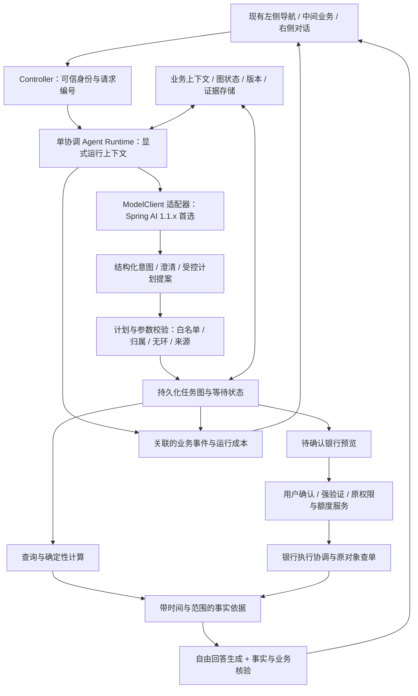

# SafeBank Agent 架构调研与改进建议

> 后续讨论已更新方向：用户确定 MySQL，Agent 层转向评估 Python 官方 LangGraph，Java 保留银行业务。见[最新选型记录](2026-10-10-架构与MySQL选型确认.md)。本文以下首选路线保留为当时的研究结论，不作为当前实施指令。

2026-10-10，Asia/Shanghai。代码基线 `6a954bf`，分支 `feature/v0.6-business-context`。本文是调研与建议，尚未安装框架、编写迁移代码或修改运行库；本轮新增 DeepSeek 调用为 0。原 8096 与候选 8110 保留。

## 1. 推荐结论

推荐目标：**Java 模块化单体 + 单个对话协调 Agent + 结构化任务提案 + 持久化受控任务图 + 独立的银行权限与账务执行模块**。

模型接入优先评估与现有 Spring Boot 3.5 匹配的 **Spring AI 1.1.x**。图编排优先做 **LangGraph4j provider-neutral core** 的小范围兼容与恢复验证，验证通过后再采用；不能将“加 Spring AI”当成已经实现 DAG，也不能直接把最新 Spring AI/LangGraph4j 集成依赖粘进当前 pom。备选为 LangChain4j + LangGraph4j；Python LangGraph + Java 银行业务适合团队以后具备独立 Python 工程维护能力时重新评估。

这是基于团队规模、代码资产、赛题要求和费用约束的工程判断，尚不是经过本项目构建验证的版本组合。模型层和图层分开决策，银行服务保持现有 Controller / Service / MyBatis / Entity / DTO / VO 分层。框架承担通用模型与编排能力；资金授权、日累计、金额计算和最终回执仍由业务代码判定。

与上一条初步建议相比，研究进一步明确：Spring AI 单独接入只能改善模型和工具基础设施；本项目还需要显式任务依赖、持久化等待和人工恢复，必须单独设计任务图及其执行契约。

## 2. 选择依据与约束

- 团队四人，仅一人擅长 Java/后端，其他成员基本熟悉 AI 使用；每日投入和比赛最终接口未形成新的确认，本报告不据此承诺工期。
- 现有 Java 21、Spring Boot 3.5.6、MyBatis 3.0.5、H2，已完成权限、账务、原动作恢复和四表业务上下文。保留这些能力能降低迁移风险。
- 依据团队提供的[赛题分析](<LOCAL_PATH> DAG、中断/回退/人工接管。
- [往届经验](<LOCAL_PATH>
- 用户核心诉求是结合业务数据灵活回答；模型额度有限，不能用增加常驻模型角色和反复付费整组测试代替设计改进。

## 3. 当前项目已经具备什么

| 已有资产 | 实际作用 | 迁移处理 |
|---|---|---|
| `ModelClient`、`DeepSeekModelClient` | 模型请求接口与供应商适配 | 保留 Interface，新增框架 Adapter，可与原生 Adapter 对照验证 |
| `BankToolGateway`、各领域 Service | 白名单工具、参数转换、账单/账户/预览业务 | 保留业务 Service；逐步用明确类型的工具描述替换手写协议 Map |
| `AuthorizationGateService`、日累计、验证服务 | 动作授权、额度占用、模拟强验证、提交时再校验 | 保持唯一权威执行路径，不迁入模型提示词或框架确认布尔值 |
| `BankAdapter`、执行/观察服务 | 银行模拟及故障注入、UNKNOWN 查原动作、账务回执 | 保留稳定 action_id/期次与整数分；框架重放只能读取或恢复原对象 |
| `ContextService`、四表上下文 | 参数来源、轮次幂等、原查询快照、刷新恢复 | 作为业务状态权威来源；补全持久化运行信息并简化双份历史 |
| `WorkflowService` | 撤销代扣后按已核验节省生成储蓄预览、版本与取消 | 保留其业务规则和已执行证据，逐步将流程定义移交受控任务图 |
| `GroundedAnswer`、语义审核、调试预算 | 程序核验事实、审核业务含义、限制模型发送 | 保留安全与预算要求，拆开职责，适配框架每次实际发送 |

所以当前工作不是从零重建银行系统，而是整理 Agent 编排、任务规划和回答证据的接口。

## 4. 当前需要改进的具体证据

以下行号对应本轮代码基线；文件长度只是导航信息，不作为架构好坏的评分。

| 观察 | 代码或验收证据 | 业务影响及建议 |
|---|---|---|
| 一个类承担较多编排职责 | `AgentService.java:24,111,248` 包含总提示词、模型循环、工具 JSON、会话裁剪、修正和兜底；共 275 行 | 一项规则改变往往牵动请求、审核和输出；将循环、工具注册、消息构建、回答流水线分离到清晰 Module |
| 状态存在多份表示 | `AgentService.java:111` 读取 HttpSession conversation/answerEvidence；`ContextService` 同时存结构化状态；`ContextAgentSupport` 用 ThreadLocal | 刷新虽能恢复，模型消息历史并非统一持久化运行状态；图/异步执行跨线程还需显式 RunContext，不能直接搬 ThreadLocal |
| 语义理解仍受字符串规则影响 | `ContextValidationService.java:63` 的 infer 和 explicit 使用正则、包含匹配 | 新说法常需要补规则；采用模型结构化提案和参数来源核验，无法验证的选择要求确认，保持金额/归属/授权的确定性校验 |
| 联合任务是固定流程 | `WorkflowService.java:166` 按 mandateIds 逐个撤销，之后生成 schedule | 能恢复已有固定任务，但缺少独立的计划节点、依赖边和自然语言提案校验，不足以展示受控任务 DAG |
| 回答核验与数字/语法处理耦合 | `GroundedAnswer.java:350` 附近 render/数字规则及计算、事实目录，整个类 608 行 | “八成”等未经计算的表达被拒是正确保护，但生成与计算契约不顺畅导致修正循环；完善确定性指标，再优化回答证据协议 |
| 审核输入偏完整 | `GroundedAnswer.java:230` modelReviewCatalog 请求完整交易明细；`BusinessAnswerReview.java:51` 使用历史、完整事实、候选回答 | 审核也需成本预算；先提供候选引用事实及比较所需全类别，信息不足再扩展，不能为了省 Token 隐去能反驳排名的类别 |
| 决策事件关联可加强 | `RiskEventService.java:12` record 生成新 requestId；模型 trace 是字符串；银行引用保存在轮次回执 | 已有审计，不应称其不存在；补 conversationId/turnId/toolCallId/planVersion/actionId 的关联，能还原一次业务决策与执行过程 |
| 候选的刷新恢复不等于进程恢复 | context-demo 用 H2 内存；`ContextRecoveryService.java:10` 启动时统一中断 PROCESSING | 候选重启清库；旧文件库上下文迁移未完成。持久化图需要受控数据库迁移、原对象恢复及单实例租约约束 |
| 模拟身份与模拟验证 | `SessionController.java:20` 设置合成用户 u1；验证 assurance 是 DEMO_VERIFIED | 适合本地演示；真实用户/渠道接入需要可信身份和真实验证 Provider，不能以框架 HITL 替代 MFA |

成本和质量依据来自本项目[真实调试记录](evidence/2026-10-10-business-context/real-debug.json)：三轮成功返回使用 4、2、4 次供应商请求，9 次生成、1 次审核。输入 69,862 Token、输出 1,640，输入占合计的约 97.7%；两轮安全兜底、一轮自由回答通过。另一次连接失败计入总预留 11/20，usage 未知。这是三轮小样本观察，不是整体通过率基准；分类比较已有本地修正，尚未付费复测。

主要成本改进方向应是减少无效修正、重复历史和不相关事实输入，同时保留必要核验，而不是只缩短回答文字。

## 5. 方案比较

“学习/迁移成本”按当前团队与项目判断，不是框架性能测评。框架公开能力不等于本项目已集成成功。

| 方案 | 对现有 Java 资产的适配 | 任务图与人工恢复 | 主要成本/限制 | 判断 |
|---|---|---|---|---|
| 原生 Java 编排继续扩展 | 高 | 需要继续自写、验证和维护 | 短期改动少；通用协议、恢复和监控责任持续增加 | 保留为迁移对照与回退路径 |
| Spring AI 1.1.x + 受控任务图，优先评估 LangGraph4j core | 高，复用 Spring DI 与 ModelClient | 图、checkpoint、人工恢复由独立图层承担 | 需验证 Core、Jackson、持久化 Saver 及发送前预算 Hook；最新 integration 不能直接接 | **推荐目标路线，分阶段验证** |
| LangChain4j + LangGraph4j | Java 适配高，AI Services/Tools 等抽象完整 | 图层可组合；框架的 agentic/其他实验能力需单独核查 | 会换一套模型消息与工具抽象；选稳定核心而非一次启用所有 Agent 模块 | 可行备选，若薄适配验证更好可改选 |
| Python LangGraph + Java 银行后端 | 银行 Service 可通过受控接口保留 | 官方图/checkpoint/interrupt 能力直接可用 | 双语言、两进程、身份传递、跨服务恢复和部署均需维护 | 当前团队暂不首选；以后可重新评估 |
| AgentScope Java | 提供 Java Agent 和权限/人机能力 | 具备相关设计与能力，需核查实际恢复落地 | 完整运行时引入范围更大，框架权限与银行三级政策仍不同 | 作为接口、事件和人机协作参考 |

官方定位：LangChain 提供标准 Agent 循环、模型/工具抽象；LangGraph 提供状态图、持久化、人机介入等运行能力。[LangChain 架构](http<LOCAL_PATH> LangChain4j 提供 Java 模型/工具/记忆与高层 AI Services。[LangChain4j](http<LOCAL_PATH> LangGraph4j 是受 LangGraph 启发的独立 Java 项目，支持与 Spring AI 或 LangChain4j 组合，不能据此声称它与 Python LangGraph 每个 API 完全一致。[原始仓库](http<LOCAL_PATH>

## 6. 版本和能力必须先验证

现有 Boot 为 3.5.6。已核查 Spring AI 1.1.8 官方发布，而当前最新 Spring AI 文档展示 2.0.1；本项目不能照未版本化文档直接升级。[1.1.8 发布](http<LOCAL_PATH> 工具文档](http<LOCAL_PATH>

LangGraph4j 发布线和 integration 的依赖版本并不等于 Core 的要求；固定 v1.8.27 Core 使用 Java 17 并声明 Jackson 2.21.1 的 provided 依赖，其父 POM 的 Spring AI integration 则指向 2.0.0。需要核验本项目 Boot 管理的 Jackson 与选定发布 tag 的实际兼容，不能把 Java 21 足够当成所有依赖都兼容。[Core pom](http<LOCAL_PATH> POM](http<LOCAL_PATH> 更详细的版本、稳定/实验能力和 DeepSeek 协议核查见附属报告。

Spring AI 1.1 工具执行可以由调用方控制；移植初期必须确保已有工具白名单、每次模型发送的预算和写操作确认不会被内部自动循环绕过。[User-Controlled Tool Execution](http<LOCAL_PATH> 不采用当前 2.0 的配置示例来假定 1.1 行为相同。

两项直接影响费用的限制需要单独处理。固定 Spring AI 1.1.8 RetryUtils 默认最大尝试次数为 10，迁移时应改为单次尝试，并让外层修正/审核继续在实际发送前统一预留额度。[重试源码](http<LOCAL_PATH> 原生 DeepSeek starter 1.1.8 的 Options 和请求 record 无 thinking 字段，不能原样设置当前请求的 `thinking: {type: disabled}`；关闭框架内部工具执行不等于关闭模型思考。模型抽象可继续评估 Spring AI，但供应商请求层需要自定义映射，或保留当前 Adapter，不能直接宣称 starter 可无修改替换。[固定 Options](http<LOCAL_PATH>

这些都应先用本地假供应商验证：工具调用参数、finish_reason、thinking 配置、失败重试、usage 和费用预留；供应商模型别名及响应实际 model 也应进入观测。尚未运行的组合保持“待验证”标签，不自动更换用户模型配置。

## 7. 建议目标流程

运行图可以有“查询→回答→有限修正”的循环；**赛题的业务子任务 DAG 必须另外明确节点和依赖并做无环校验**。不能把 Agent 的工具循环画成图就称为完成复杂任务 DAG。

推荐至少能提案出以下例子：查询指定月份 → 准备本人代扣查询并等待确认 → 明确选择音乐/视频 → 分别生成撤销预览并等待授权 → 核对撤销回执 → 按已核验月付金额计算预计节省 → 补充日期与储蓄对象 → 生成储蓄预览。撤销结果 UNKNOWN 时阻断其节省计算及后续储蓄；已完成金额不能靠任务回退直接撤回。

模型只给有限节点类型、输入和依赖；服务器填用户身份、真实对象 ID、风险和授权状态。模型不能输出“已授权”来改变银行状态。

## 8. 模块接口如何整理

应用入口可收敛为 `AgentRuntime.run(TurnCommand): TurnResult` 与 `resume(ResumeCommand): TurnResult`，其中必须包含归属、版本、幂等和错误契约。本文不固定未来代码签名；具体命名在实施设计时与现有 DTO/VO 对齐。

| Module | Interface 应隐藏的复杂度 | 实际 Seam / Adapter |
|---|---|---|
| 模型调用 | 协议、finish_reason、异常、usage、每次发送预算 | 沿用 ModelClient；原生与 Spring AI 两个 Adapter 提供真实替换点 |
| 对话运行 | 消息构建、节点路由、澄清、有限修正、返回事件 | AgentRuntime 内部编排，Controller 不依赖框架消息类型 |
| 业务上下文 | 最新有效槽、证据时间/来源、版本冲突、恢复 | 保留 ContextService 持久化；HttpSession 主要用于身份和会话索引 |
| 任务规划与执行 | 允许节点、依赖、等待与恢复、参数修改 | 图 Runtime Adapter 仅调既有业务 Interface，不直接写 Mapper |
| 回答与证据 | 完整事实→与问题相关依据→自由解释→核验 | 分开事实目录、确定性指标、候选回答、核验结果和聚焦兜底 |
| 银行权限与执行 | 授权、期限、额度占用、提交/观察、幂等 | 已有银行 Service/BankAdapter 保持权威，所有渠道共用 |

这使用 codebase-design 的 deep Module 思路：调用方知道一个稳定 Interface，复杂实现留在 Module 内部；优先利用已有 ModelClient / BankAdapter 的真实 Seam。避免为每个提示词片段新增只有转发功能的类，也避免把每个 Module 都变成一次 LLM 调用。

## 9. 改进优先级

| 优先级 | 改进 | 可验收结果 |
|---|---|---|
| P0 | 明确消息/工具/回答契约，计算目录补齐问题所需指标，修正次数有明确状态与上限 | 同一账单的总览、单笔追问、跨月比较回答侧重点不同；不因一句比例描述反复调用或降级为无关总览 |
| P0 | 缩小相关输入，保留必要全类别与来源；预算在真实发送处执行，关闭未受控 SDK 重试 | 本地假服务可统计每次请求、失败/修正/审核同计数；新 Adapter 第 21 次不得发送，原共享账本不清零 |
| P0 | 收敛业务状态来源并把 RunContext 显式传递，分离会话身份与 Agent 消息 | 新执行路径不依赖 ThreadLocal 跨异步线程；刷新/换连接不改变对象、原预览与版本 |
| P1 | 框架模型 Adapter 接入，对照原生路径 | 现有账务/权限断言继续通过；工具协议错误、供应商失败不会产生资金动作或自动重试 |
| P1 | 受控计划 DAG、持久化等待、人机恢复和计划版本 | 用户能查看并修改未执行节点；中断恢复沿用原动作，UNKNOWN 阻断依赖，旧确认不适用于改参后的提案 |
| P1 | 受控迁移到持久化数据库、图 checkpoint 与业务版本对应 | 进程重启后能恢复等待任务；区分节点状态与银行回执，不能用内存 Saver 通过刷新测试冒充重启恢复 |
| P1 | 关联决策事件、进度与证据展示 | 界面显示已查询/待澄清/待确认/待验证/暂停/已核验；一个 turn 能追溯到对应节点、工具和回执 |
| P2 | 更多渠道、真实身份/MFA、领域知识检索与外部银行接口 | 以官方接口和身份接入要求单独验收；产品规则/金融知识可检索，账户金额仍来自授权业务查询 |

语义审核优化应先建立可比较的留出用例。保留金融分析的事实核验及必要语义审核；是否能减少一般说明/澄清的审核调用，属于后续明确路由设计，不能直接关闭全部审核。

RAG 的合适数据是产品说明、术语和业务规则；余额、实时授权、交易终态不应通过向量相似度检索判断。现阶段不增加训练、金融 CoT、多方联邦学习或五个常驻模型角色。

## 10. 建议迁移顺序与停止条件

1. **先冻结比较基线。** 保留当前合成库与原生 Adapter 的输入、输出来源、事实依据、请求次数和错误；小样本事实明确标注，区分安全失败与不相关回答。
2. **整理通用契约。** 明确 TurnCommand/TurnResult、工具元数据、AnswerDraft/ValidationResult、显式运行上下文；金额、策略和执行不重新实现。
3. **做模型 Adapter 离线适配验证。** 选固定 Spring AI 1.1.x tag，核对 Boot/Jackson 依赖；接本地假 HTTP 供应商，验证 DeepSeek 协议与发送预算。这是下一阶段建议的第一个技术交付点。
4. **做图 Core 的离线恢复验证。** 两个查询节点、一个需确认的银行预览、一个依赖回执的计算节点足够；暂停、重启、重复恢复、版本冲突和 UNKNOWN 全部可观察。兼容性不通过就停止合入，不顺带升级整套 Boot。
5. **将一条真实业务流程移交图层。** 沿用原 action_id/授权/已执行证据，逐步替换固定 WorkflowService 的编排部分，按原 HTTP 契约返回。
6. **补产品进度与文档。** 左中右布局保持；先推可信业务状态/依据，未经核验的模型数字和成功声明不提前展示。领域角色是否拆 Agent 由独立需求和调用收益决定。

迁移可在新分支/特性开关下对照，先迁一个场景。达到当前交付点即停止扩大测试；只有新改动或真实失败才补相应验证。本文不包含完整实施任务清单或数据库 DDL，避免在选型研究阶段把未经验证的版本组合变成开发承诺。

当前本轮调试账本已经 11/20。调研不发送模型请求；以后若做真实适配验证，应沿用同一账本剩余额度及用户届时授权，绝不能因换框架/分支/进程重新获得 20 次。

## 11. 图恢复与金融执行的特别要求

LangGraph 官方说明中断/恢复会从相关节点起点重新执行，暂停前的副作用需幂等。[Interrupts](http<LOCAL_PATH> API 的恢复说明](http<LOCAL_PATH> 不能将 checkpoint 的存在等同于银行“恰好执行一次”。

图状态至少关联用户/会话/计划版本/节点/原 action_id/输入哈希/证据版本。银行授权仍绑定实际动作及参数；恢复先读取原动作/回执，不能为重跑节点重新生成银行 UUID。取消/回退只修改未执行节点；已执行资金需要另一个合法业务动作及新授权，不能通过图 rollback 撤销。

模型和银行请求不要放在持锁的长数据库事务中。图 checkpoint 与银行业务数据之间若不是同一事务，必须记录执行意图与观察并靠原 ID 核对；进程崩溃后的资金 UNKNOWN 只查单，不进入框架默认自动重试。

`ContextRecoveryService` 当前启动统一标记 PROCESSING 中断的策略有单实例前提。多实例前必须增加带实例归属的租约/心跳或等价设计，不能直接同时启动两台持久化节点；Redis/Kafka/K8s 等基础设施只在确有相应需求时选用。

## 12. 框架选型验收门槛

| 检查 | 通过标准 |
|---|---|
| 依赖 | 固定 tag 可构建，Boot 3.5 当前配置不被强制迁到 4，Jackson/工具序列化无冲突 |
| 供应商协议 | 工具 JSON、thinking 关闭、finish_reason、失败/超时、usage/缓存字段正确映射，实际返回 model 可记录 |
| 调用预算 | 每次真实发送先预留；内部重试、修正、审核同计数；失败不退额，不另起正式账本 |
| 权限 | 模型不能构造用户/授权状态；所有写操作仍需原参数哈希、风险决策与有效授权 |
| 图与持久化 | 显式依赖/无环校验，等待不占线程；重复恢复无重复银行动作；旧版本确认失败 |
| 原有行为 | 整数分、借贷平衡、日累计与 UNKNOWN 等关键账务断言保留；示例框架测试不替代这些断言 |
| 回答质量 | 用固定问题观察总览/聚焦/比较/澄清是否答所问，记录首轮核验、兜底相关性、请求与 Token；不能只看 BUILD SUCCESS |

这些门槛尚未在框架 Adapter 上运行。本轮只验证研究文档与当前源码证据，不重跑 270 项测试，也不宣称性能、费用或回答质量已因框架改善。

## 13. 团队可分工的实际交付

Java 主力负责框架 Adapter、图与持久化、银行接口契约；一名成员整理用户表达、缺参/否定/改口和期待回答；一名成员整理固定业务用例与证据/请求用量；一名成员负责进度卡、演示链路和材料。后三位不需要被假设为能独立开发复杂后端。

下一步应先审阅本报告的目标架构及版本约束，再为“模型 Adapter 离线适配验证”写一个范围有限的设计与实施安排。架构研究结论不等于已经授权实施迁移。
