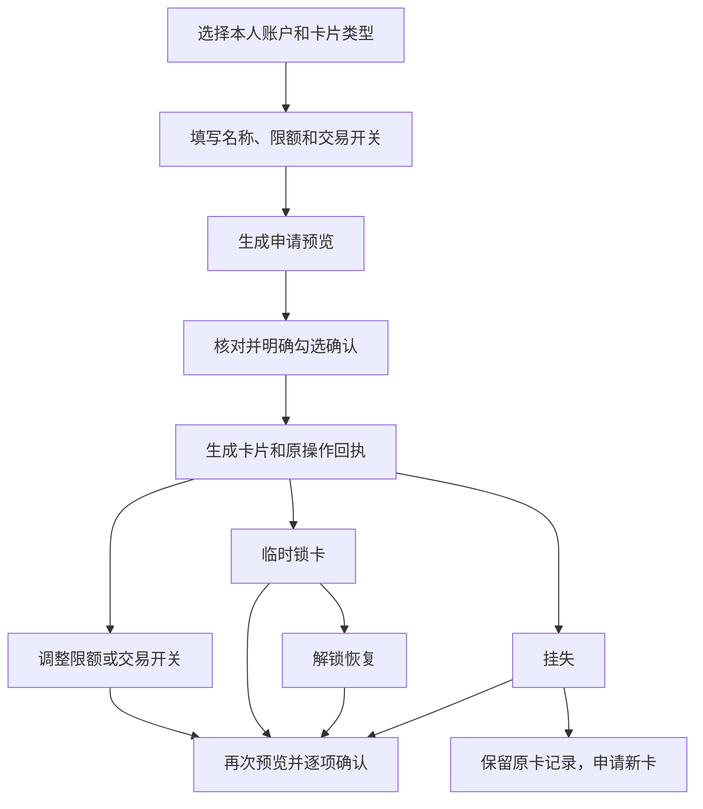

# 工作台完善与卡片管理

## 实施范围

1. 账单分析：按实际数据列出月份，默认最新月份；将交易明细作为独立板块，支持日期、金额、类别、收支和关键字筛选、排序及分页。月度统计与筛选后统计分开展示。
2. 用户管理：维护当前用户的合成联系人资料及关联账户，新增/编辑姓名、手机号、性别、备注。所有转账、定时储蓄、联合任务的选项均从同一数据源取得。余额来自账务查询，不允许编辑已有账户余额。
3. 储蓄任务：保留查询授权流程，在“明确选择代扣”原地提供查询和结果；有效月付项目可勾选，其他项目解释不可选原因，并显示已选金额。
4. 卡片管理：卡片总览 → 选择关联账户 → 申请合成卡片 → 查看卡片 → 预览限额/交易开关/锁定/解锁/挂失 → 明确确认 → 保存操作记录。挂失不可直接解挂；重新申请使用新卡。卡片状态独立于账户余额，卡片限制不阻断账户转账。
5. 下拉框：统一尺寸、焦点、可读选项、空状态与来源提示；联系人支持检索，键盘可以操作，不再硬编码联系人及储蓄目标。

## 卡片管理的设计思路

以现有账户和余额为基础，先把“申请、限额、交易开关、锁定、解锁、挂失”做成完整流程。提供储蓄卡和虚拟卡两种演示类型；此处的额度调整指单笔/每日交易限额。

卡片是账户的使用入口，同一账户关联多张卡时共用账户余额，避免给每张卡重复增加一份资金。卡片展示关联账户、脱敏演示卡号、可用余额、限额、交易开关及状态，挂失记录保留。

每个预览有效 10 分钟，并绑定当前卡片版本；其他操作改变卡片后，旧预览须重新生成。网络失败时通过操作记录查询原状态；重复确认返回原回执。每位用户最多保有 8 张未挂失卡，锁定中的卡也计入数量。

当前卡片限额和开关保存为本地演示设置。后续接入卡支付模拟器时，可在支付授权环节按“卡片状态 → 渠道开关 → 单笔限额 → 当日累计限额 → 账户余额”的顺序判定，并将消费流水接入现有账单分析。授信、真实开户和真实支付网络接入属于后续独立建设内容。

## 页面使用流程

1. **账单分析**：选择月份，先看月度支出、收入和分类，再在独立的“交易明细”板块按日期、金额区间、类别或关键字组合筛选，切换日期/金额排序。筛选后统计显示匹配记录的收支，月度总览保留整月口径。
2. **用户管理**：编辑本人的姓名、手机号和性别；添加联系人，选择关联本人账户或创建合成收款账户，填写资料并标记是否作为储蓄目标。保存后转账和储蓄下拉框自动同步；已有账户余额来自账务数据。
3. **储蓄任务**：在“明确选择代扣”处点击查询，核对并确认查询范围，再勾选有效月付项目。页面显示选择数量和预计月度节省金额；非月付、已撤销项目解释不可选原因。随后选择付款账户、储蓄目标与日期，创建任务并按原流程逐步确认。
4. **卡片管理**：点击“申请演示卡”，选择本人账户并生成预览，勾选后确认申请；在卡面操作设置、锁卡、解锁或挂失，并从“卡片操作记录”查询原预览和回执。

## 数据与边界

- 沿用 Controller → Service → MyBatis Mapper，金额为整数分，归属取自会话，写请求沿用 CSRF。
- 新功能使用独立版本迁移；不修改既有迁移的校验和，不重建或清空现有数据。
- 用户管理仅展示本演示用户维护的合成联系人及关联演示账户，不提供任意真实用户或账户余额查询。
- 7、8月如已有合成账单则直接展示；缺少的月份补充幂等合成样本。历史样本不改变当前余额。
- 卡片申请、限额、锁定、挂失均为本地合成银行功能，不宣称已接入真实发卡银行或支付网络。
- 卡片操作预览绑定原卡片版本，过期或状态变化后须重新预览，重复确认沿用原操作结果。

## 验证计划

- 服务层与 HTTP 回归：用户归属、输入校验、联系人与账户映射、月份及收支口径、卡片状态机、版本冲突、重复确认。
- 浏览器验证：月份切换、交易筛选/排序/分页、添加/编辑用户后选项同步、代扣勾选、卡片申请/限额/锁定/解锁/挂失。
- 桌面与手机宽度截图检查；运行现有回归及构建。模型联网对话单独记录，不因页面修改自动发送付费模型请求。

## 验收记录

2026-10-24 已完成实施，并更新本地运行的应用：<http://127.0.0.1:8134>。

- Java 回归：共 427 项，实际执行 352 项通过、75 项按配置跳过，失败和错误均为 0。新增工作台回归 13 项通过，覆盖月份、用户归属、输入校验、余额不可编辑、卡片状态、过期、版本冲突、回执幂等和并发持卡上限。
- JavaScript：`app.js`、`workspace.js` 语法检查通过；现有上下文请求回归 7 项通过。
- 独立 H2 环境完成浏览器验收 7 组：月份和统计、组合筛选/排序/分页及键盘操作、用户资料与共享选项、代扣查询和勾选及完整储蓄任务、卡片完整状态流程、HTTP 归属/CSRF 校验、1440/1024/768/390 像素适配。页面错误、服务端 500 和模型请求均为 0。
- 独立 MySQL 副本完成 V6 迁移、用户增改、卡片限额/开关/锁定/解锁/挂失、重复确认以及不同账户并发申请验证；重启后资料、卡片设置和原始回执完全一致。修复了并发申请突破持卡上限、首次确认与重读回执的时间格式不一致问题。
- 实际 MySQL 升级前已备份。升级后核验原有 29 张业务表：28 张表的全部行数和内容指纹一致；`agent_gateway_turns` 原有 38 行身份和业务字段一致，仅既有后台定时恢复任务更新了 8 行的 `next_check_at`。账户、余额、账单、授权、资金动作和任务数据保留。
- 运行应用的只读浏览器检查通过：8 个入口、7/8/9 月账单、筛选与共享选项、4 种屏幕宽度正常；没有尝试任何 API 写入或模型调用。本机数据已有 4—9 月历史账单和 10 月既有转账，月份列表随实际数据更新。

可复现检查脚本：

- `fixtures/workspace-management-qa.cjs`：仅在一次性离线 H2 环境执行完整浏览器写入验收。
- `fixtures/workspace-mysql-qa.cjs`：仅在一次性离线 MySQL 副本执行持久化和并发验收；`--verify-persistence` 核验重启保存。
- `fixtures/workspace-readonly-smoke.cjs`：运行应用的只读检查，阻止 API 写入和模型请求。

本次报告与截图位于 `target/workspace-qa/`；升级前备份位于忽略目录 `.team-local/backups/`。测试没有发送付费模型请求；真实银行、发卡与支付网络没有接入。
