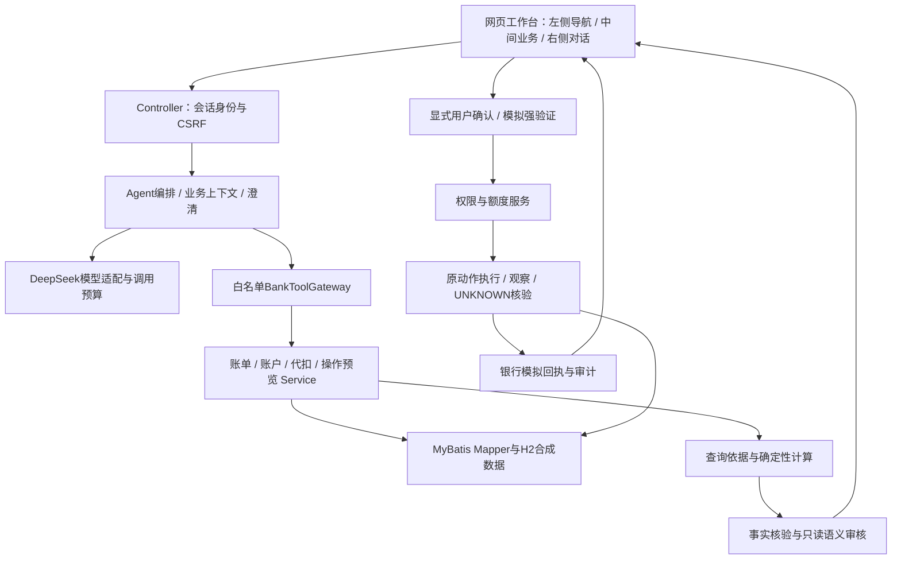
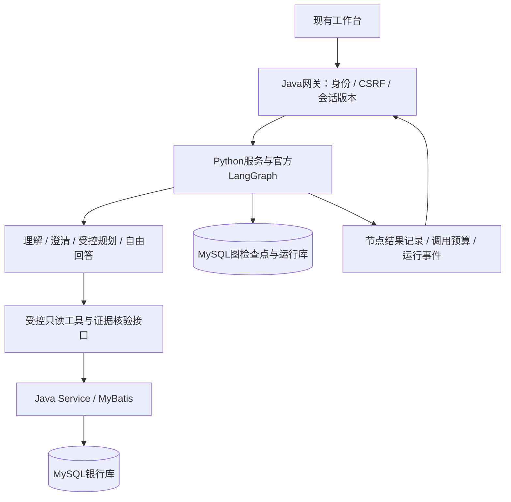
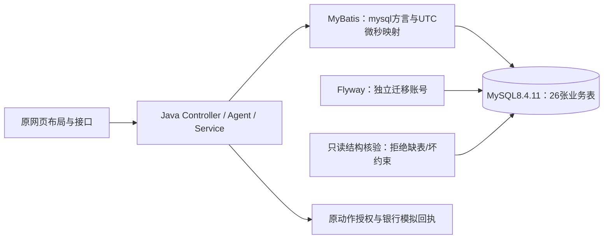
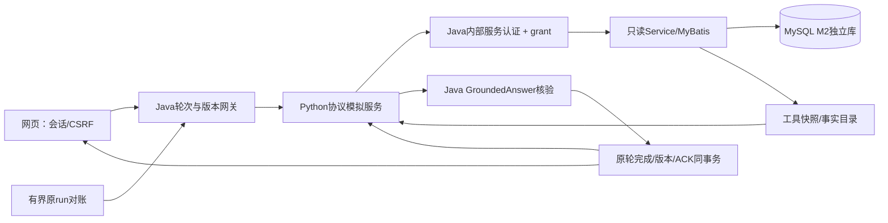
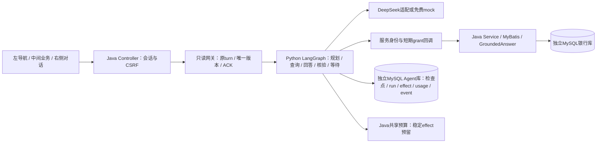
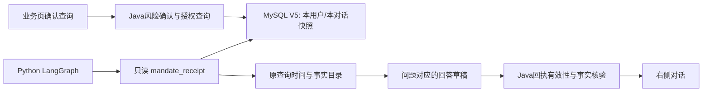

# SafeBank 技术文档：系统架构

2026-10-14本地增量：Python官方LangGraph可提出有限储蓄任务图；Java独立检查五类节点、依赖和对象归属，再编译至原WorkflowService/MyBatis状态机。新增工具仅savings_task_prepare（登记）和savings_task_status（查询），授权/执行仍走原用户操作入口。无需新工作流表或通用引擎。原8134服务及GitHub快照未替换；以下历史图不代表本轮增量已部署。证据见[任务图阶段验收](../2026-10-14-savings-task-plan-验收.md)。

当前阶段：M3正式Python LangGraph与MySQL检查点已接入，8134为独立候选；默认免费模拟模型。下文M0—M2历史记录保留，当前实现以末尾M3阶段及证据为准。
2026-10-10，阶段草稿r3。面向参赛技术文档，现有实现与目标架构分列；尚非最终提交版。现有银行、资金与身份均为本地合成演示。

## 1. 问题与创作理念

客户希望用自然语言完成账单理解和银行操作。系统需要承接省略、补参与改口，同时让金额、授权和交易终态有可核验来源。SafeBank采用模型理解与解释、程序计算与安全执行的协作方式，让每项敏感操作对应明确对象、参数和授权。

## 2. 已实现架构：Java候选v0.6

Java21、Spring Boot3.5.6、MyBatis3.0.5、H2是现有实现。前端是现有HTML/CSS/JavaScript工作台；未在当前材料中宣称React/Vue重写。DeepSeek请求遵循用户配置，模型名称是供应商别名，不能等同于永远固定的权重版本。

已覆盖账单、转账、代扣管理与固定联合储蓄流程。领域Service和Mapper分工明确；模型工具只查询或生成预览，授权和提交走用户操作入口。24张表包含13业务表、7风险表和4上下文表。候选上下文使用H2内存，刷新恢复不代表进程重启持久化。

## 3. 目标架构：v0.7设计待实现

Python负责Agent运行，Java负责可信身份、确定性业务与账务。一个MySQL实例、独立bank/agent数据库和最小权限账号；Python不能直接写银行表。首阶段仅迁只读账单，不开放模型资金工具；未来跨场景业务计划需显式DAG、版本、等待与原动作恢复。

LangGraph1.2.12、checkpoint4.2.0、社区MySQL检查点3.0.0与MySQL8.4.11已通过同步假图9项检查，包括跨Python进程恢复；此为实验，不是正式服务集成。M1已建立26张银行表；5张Python应用表仍是设计，正式Python服务未部署。稳定操作编号、两步完成ACK、Java唯一业务版本、定时对账和UNKNOWN副作用暂停均为待实现协议。[实验依据](../2026-10-10-v07检查点预验证结果.md)

## 4. 主要接口与状态原则

浏览器以Java为唯一入口，保留/api/chat及业务接口；网关取得真实会话归属后调用Python。内部服务身份与短期能力令牌不是客户资金授权。银行接口返回金额整数分、查询范围、来源时间和回执编号。

会话版本由Java产生，Python保存投影；图checkpoint保存任务位置，不是交易成功凭证。已完成查询依据可复用，需刷新时发起新逻辑查询。模型HTTP结果未知时不自动重发，以免恢复流程放大费用。

## 5. 工程边界与证据

已有Java/MyBatis、业务规则、合成数据和关键断言复用；新服务、端口与库隔离，原v0.5/v0.6候选保留。当前不宣称具备真实登录、真实MFA、官方银行接口、通用代码执行沙箱或全部场景覆盖。

实现与实验状态对应[材料证据索引](材料进度与证据索引.md)。最终技术栈版本、部署图和接口清单在实际迁移交付后补全，不用目标图替代运行事实。

## M1 阶段更新：MySQL业务基础（2026-10-10）

此图为M1实际候选；Python服务与ACK不在该运行链路中。

独立8130候选复用现有Java/MyBatis业务，MySQL8.4.11建立26张业务表；原8096/8110/8111入口保留。运行账号无DDL权限，启动只读核对完整V1/V2列、CHECK谓词和复合归属键；不自动修复坏库。UTC微秒时钟和专用类型处理器、二进制NO PAD比较、原payload/hash、种子数据口径与账务回滚已在合成范围验证，见[M1验收](../2026-10-10-v07-mysql-foundation-验收.md)。

grant/tool receipt两表仅有存储结构，内部认证、令牌续签、工具回调、JavaACK和对账仍待实现。Python官方LangGraph正式服务尚未建立；M0是假图实验。本阶段DeepSeek请求0次，不证明模型回答质量改善。Flyway11.7.2对MySQL8.4有支持范围警告，正式部署前另验受支持组合。作品简介沿用当前可演示能力，PPT/视频与最终源码发布包继续暂缓。

## M2 阶段更新：只读 Java Agent 网关（2026-10-10）

8132独立候选已接入模拟Python协议服务，MySQL独立M2库27表，原M1库26表保留。内部服务凭证+短期grant双重核验，四种只读scope、每轮8次新查询、5分钟/会话TTL、跨续签配额与原快照回执、幂等Java版本/ACK及有界对账已实现。页面明确显示“网关协议模拟”，未调用DeepSeek。正式官方LangGraph图、Python运行持久化/租约/interrupt与预算effect仍待M3，不把fake协议验收称为生产Agent验收。[M2验收](../2026-10-10-v07-agent-gateway-验收.md)。

旧版网页已按用户授权停止，代码/原包/数据保留；当前只运行8132网页、8133fake和3307 MySQL，数据库文件在D盘。V3独立profile不修改旧V1/V2。Loopback身份、资金与数据均为模拟，无生产TLS、真实登录/MFA或真实银行；R03模型质量、R05真实跨服务运行、R13依赖兼容范围仍开放。

## M3 阶段：正式 LangGraph 只读服务

候选采用原Java21/Boot/MyBatis与固定Python3.12/LangGraph1.2.12同步组合。社区MySQLSaver3.0.0提供检查点，不是LangGraph官方MySQL实现。银行库28张业务表（V4保存Java受理的模型上限），Agent应用五表加迁移记录及Saver表；银行、Agent运行账号分库DML，迁移账号独立。运行时只读检查表结构与迁移摘要，不自动修复。

Python负责问题理解和回答重点，Java提供银行事实、结果核验和唯一业务版本。工具仍限账单、跨月比较、周期分析、账户查询四项；资金操作由原Java业务页控制。graph的wait节点只等待，补参是新Java轮次，不重复旧模型调用。单Python实例串行写检查点，后台队列有界；不宣称分布式checkpoint fencing。

M2原包/分支与数据库保留；MySQL数据文件仍在D:/SafeBankRuntime。当前网页8134，Python8135。默认离线模拟模型标签明确；框架接入不等于模型问答质量或真实银行接入。详见[M3验收](../2026-10-10-v07-langgraph-验收.md)。

## 2026-10-11 确认查询共享边界

当前银行库29张业务表（新增V5代扣确认回执），工具范围增加第五项mandate_receipt；其余M3分层和运行拓扑不变。Python只能读取Java签发grant对应的本用户/本对话有效快照，不能新查代扣或代签确认。网页创建空对话后显式绑定CID/version，原Action卡完成查询授权。Java在工具重放及最终回答时重新查有效回执，撤销与重置在原事务中失效快照。

免费实际网页流程与并发回归见[接入验收](../2026-10-11-已确认代扣对话接入.md)。不把模拟模型输出证明为真实生成质量。

2026-10-15阶段补充：模型HTTP明确拒绝和未知响应分开记FAILED/UNKNOWN，均不自动重发；Java固定白名单说明原因，不回显供应商正文，不自动释放轮次或授权。无需数据库迁移。实现与验收范围见[后端稳定性验收](../2026-10-15-后端稳定性改造验收.md)，更多真实和人工案例见[统一矩阵](../2026-10-15-下一阶段验收矩阵.md)，尚非最终比赛全场景验收。

原请求恢复阶段：前端未完成请求的identity/version不可被新文本覆盖，刷新不自动提交；Service统一校验状态查询归属，以固定VO保持接口兼容、不返回内部正文。Node2、Java10、MySQL21及桌面/手机免费浏览器验证通过。明确拒绝后的人工结束与真实模型恢复仍待验收，见[阶段记录](../2026-10-15-原请求恢复与状态接口改造.md)。
