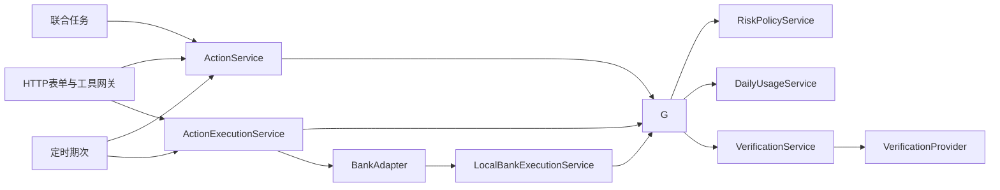

# SafeBank 三级权限、日累计与验证设计

日期：2026-10-09。代码基线 `ba41b70`，原冻结demo为 `0f93f85`，8096现已切换v0.5候选。状态：设计及实施已完成，隔离合成验收通过；实际结果见[实现验收](../../2026-10-09-三级权限实现验收.md)，不代表生产MFA或旧文件库迁移。

需求依据：[团队提供赛题分析](<LOCAL_PATH>

## 目标和方案选择

在既有 Java21 / Spring Boot3.5 / MyBatis 单体中补足 GREEN 自动查询、YELLOW 明确确认、RED 补充验证。模型仅理解、查询或生成预览，不提供用户身份、验证证据或授权结果；当前合成身份和挑战必须明确标识。

| 方案 | 代价 | 决定 |
|---|---|---|
| 增量权限服务、授权证据与额度占用表 | 明确数据库/事务边界，保留现有账务和工具 | 推荐，最符合一名熟练Java队员的产能 |
| 整体改用AgentScope/LangChain4j接管工具执行 | 新框架适配与授权语义回归较大，仍须自己实现日累计 | 本阶段吸收PermissionDecision接口思想，不整体迁移 |
| 网页增加验证码框，只在前端判断金额 | 后端、工具和定时任务可绕过 | 不采用 |

本阶段包含权限/挑战/日累计/有限验证锁定、相关审计、旧入口接入及必要确认卡字段。通用DAG、SSE、RAG、多Agent、真实短信供应商、生产身份系统及公开部署均为后续独立工作；网页左导航、中业务、右对话几何布局保持。

## 固定规则与假设

- 转账日累计阈值为100,000分（1000元），恰好1000元仍YELLOW，大于1000元RED。既有单笔10,000元上限作为另一条校验保留，不混淆两者。
- 本版按用户全部出账转账本金累计，包含本人账户间转账；账户/收款人/渠道不同不拆桶，退款不抵减。这是保守的项目解释，官方是否排除本人内部转账以后可配置。
- 余额、交易记录和账单查询GREEN；撤销代扣YELLOW。赛题将订阅查询列在黄色，v0.5按明确业务操作 `QUERY_MANDATES` 单独要求确认，确认后仅执行一次查询，不产生资金授权；正式解释待组委会澄清。
- 定时计划登记YELLOW，不占当日转账累计；委托范围只允许固定金额、本人/明确收款人、来源账户、周期和日期，最高授权等级YELLOW。当实际期次达RED，停止自动提交，保留原期次等待当次验证。
- 普通授权最长5分钟；验证码/外部挑战最长2分钟；均不跨业务日午夜。验证码3次失败锁该挑战；可信用户10分钟内累计5次错误锁写操作10分钟；创建挑战间隔60秒。数字为项目默认值，可配置，不声称赛题指定。
- 写操作锁定不阻止查余额、查原动作、退出/恢复页面；不把供应商超时、余额不足或客户取消计为身份验证失败。无真实身份或因子时只提供 `LOCAL_DEMO_ONLY` 合成演示模式；生产模式RED若未接真实验证供应商则拒绝执行。

## 组件职责与调用关系



图表示依赖与检查边界，不表示网络调用期间持有数据库事务。LocalBankExecutionService 在本地银行账务提交前复核“已受控受理”的证据，避免ScheduleService或测试辅助入口绕过门禁；已受理PENDING的银行完成回调不要求用户再确认，但必须有原受理记录。

AuthorizationGateService只依赖下层Mapper/codec/策略/验证服务，不注入ActionService、ActionExecutionService或LocalBankExecutionService，避免Spring构造器依赖环。执行服务调用门禁，再调用银行；门禁不反向启动执行。

Controller接受DTO、从会话取身份，返回VO；Service处理风险与事务；新增DAO/Mapper XML访问新增表；Entity对应表。模型/Controller不访问Mapper，Service不拼SQL，金融金额继续long整数分、时间使用注入Clock。

RiskPolicyService只计算等级和原因，不扣款；DailyUsageService维护额度占用；AuthorizationGateService协调动作、等级、证据和占用原子更新；VerificationService管理挑战和失败窗口；VerificationProvider提供合成挑战或真实验证适配。使用结构化 RiskDecision / AuthorizationEvidence，不用模型字符串判定。

QUERY_MANDATES新增ActionKind和类型化QueryParametersVO，复用action/decision/grant持久化，只调用受控MandateService读分支，不走资金BankAdapter、不产生usage或分录。正常直接GET代扣列表改为需查询确认的错误，前端初始化相应调整；首次查询结果随QueryExecutionReceiptVO返回，重复执行只返回原查询回执，不冒充实时结果。此项是材料歧义下的保守设计，可在官方明确后配置GREEN，具体接口见契约。

网关list_mandates在黄色模式下返回查询意图卡，而不是直接调用MandateService.list；AgentService须按显式pendingAction结果暂停并展示卡片，不能按普通查询事实渲染。后台验证归属/计划参数的内部读取不把完整列表作为未经确认的客户结果。前端refresh移除强制Promise.all中的直接代扣查询，代扣导航先展示查询范围确认，确认返回的data再填列表；账户/账单初始化不能被查询需确认错误整体阻断。

## 日累计、并发与跨日

用户级 `risk_user_guards` 行为所有额度/挑战写路径的共享锁。预览读到的等级是建议值，不能凭预览放行。授权前在短事务内锁用户与动作，清理未提交且过期的RESERVED，重新计算：

```
effective = 当日COMMITTED
          + 当日未过期RESERVED
          + 所有日期尚未核实的SUBMITTED
          （按action_id集合去重，计算当前动作时排除自己的占用）
projected = effective + 本动作本金
```

UNKNOWN/PENDING映射为SUBMITTED，跨日也保守占用；本版业务日期为受控提交时可信业务时钟之日，银行最终受理日期接口接入时须明确映射。UNKNOWN晚到成功先按原受理日结算；不得靠本地查单时间改成今日或退款冲减。本地模拟日期只在显式隔离实验实例由SimulationClock/ExecutionContext提供，同一日期用于风险判定与记账；普通HTTP输入不能改变日期。

两笔600元同时预览可都显示黄色；授权顺序由用户锁决定：第一笔占600元，第二笔重新计算1200元，需要RED证据，旧黄色确认不能生效。两个不同action即使姓名/参数相同也不能被意图文本缓存合并；同一个action重复请求不重复占额。

数据库不保存可漂移的总计缓存，用索引与锁保护占用明细求和。amount和求和检查long溢出，溢出拒绝。读业务日于取得用户锁之后，避免午夜前排队而午夜后用旧日授权。提交再次校验当天、策略版本、动作哈希、归属和有效期；同一动作在有效期内只允许升级等级，不悄悄降低已展示的红色要求。

统一锁顺序：用户guard → workflow/schedule行（多行按ID排序）→ action行（按ID排序）→ decision/challenge/authorization/usage行 → 账户行（按账户ID排序）。联合任务取消/修改和期次创建入口必须先获取用户锁；禁止现有外层工作流事务先持锁，再倒序调用权限服务。网络/模型/短信发送均在短事务结束后进行。

## 生命周期与事务

1. 预览：校验归属/参数，保存原动作，记录风险decision，不占金额；创建user guard可幂等重试，主键冲突仅重读同用户，不能更新其他人的记录。
2. RED挑战：绑定用户、动作、payloadHash、decision、策略和日期。事务内保存PENDING_DELIVERY，再在事务外投递；成功变SENT，失败DELIVERY_FAILED。换挑战撤销旧未消费挑战；过期/错误/重放不发授权。
3. 校验挑战：正确口令或可信供应商结果只产生VERIFIED证明，**不提交银行动作**。口令由SecureRandom生成；只存服务端HMAC摘要，pepper来自本机配置，口令不进入应用日志、模型消息或普通API响应。供应商回调验签与真实性由适配器实现。
4. 明确授权：用户提交payloadHash、当前decisionId、确认和可选proofId。事务内重新判定、校验证明、创建ACTIVE授权、消费挑战、保存RESERVED占用并将原动作置AUTHORIZED。若等级升级，返回需验证信息，**不抛异常后丢掉新decision**；将可审计的拒绝/新decision提交后再映射HTTP结果。
5. 提交：同一用户锁下复核grant，再将grant→SUBMISSION_STARTED、usage→SUBMITTED，原执行观察→UNKNOWN/SUBMISSION_STARTED **同一短事务提交**；随后调用原BankAdapter，调用期间无DB事务。不能先消费授权却没有观察记录，或先写观察却无占额。
6. 权威成功：账务、流水、原action终态、原audit、usage→COMMITTED、grant→CONSUMED在本地银行事务内一次提交。外部银行通过幂等查原动作得到成功时，在本地短事务原子更新观察/占用；不虚构本地已记账。
7. 权威失败：usage→RELEASED，grant→CONSUMED，保存回执/审计；普通连接失败保持SUBMITTED。未受理且明确NOT_SUBMITTED时可撤回受理标记、释放占用并恢复原动作到待授权，后续授权/提交沿用原action重新判定。
8. 取消/过期：仅未提交RESERVED可释放；grant失效、挑战作废与action取消原子更新。SUBMITTED/UNKNOWN不按TTL释放，不允许普通取消伪装成银行未执行。

验证码错误次数、锁定事件和安全拒绝必须提交，不因上层BankException整体回滚；事务返回结构化成功/拒绝结果，控制层在提交后构造错误响应。错误后不改变金额、用户身份或action_id。

## 合成验证边界

采用 `DEMO_OTP` 验证适配器，不接收费SMS。一次性验证码随机、与动作绑定、有限期与次数，但当前身份u1本身合成，不能宣称真实双因子认证。

演示口令通过独立本机验证台领取：仅显式demo-profile启用，绑定loopback、独立操作者访问令牌；不放在业务页面的同一个接口、不在普通challenge响应回传、不开放模型工具。后台令牌及OTP不写截图/报告/提交。若验证台未配置，不返回固定通用验证码，RED无法继续。将来真实供应商替换VerificationProvider，不改变业务授权接口；普通生产模式禁用演示台并要求MFA_VERIFIED。

## 定时与联合任务接入

计划登记成功与 `schedule_authorizations` 委托证据同事务保存；scope包含来源、收款人、固定金额、日期区间、月付规则、政策版本和上限等级，哈希校验且不可由模型改写。老计划无委托证据一律待重新确认，不自动回填授权。

每期在同一用户/schedule锁下复用occurrences原action_id。取消现有prepare(delegated=true)的自动AUTHORIZED语义，期次先待授权；有效委托且当前等级不高于YELLOW时，门禁产生有scope来源的授权并原子占额；RED时保留该action及期次、状态AWAITING_AUTH，提示“需补充验证”，不能创建新期次。无需新增action银行终态：security.nextStep显示验证需求，尚未提交不是VERIFIED_FAILED。

重复run-due返回原期次和当前状态；完成挑战后只对原action授权/提交。联合任务使用同样卡片与接口，未验证不能推进；UNKNOWN依赖保持暂停。定时银行PENDING完成仍查原动作，不能拿已过期用户交互授权阻止已受理结果核验。

## 旧数据与发布

原13表保持业务字段，新增7表及actions/schedules归属联合唯一约束。DDL为独立草案，不接入当前schema.sql；设计验证只用新内存库。数据库详情和预检见数据库文档。

旧未提交AUTHORIZED记录无新grant不得执行，可恢复同动作待确认；已提交PENDING/UNKNOWN先查旧动作并建立占用，无法确定提交日时保守锁转账写入口等待人工核对；终态动作从可信账务重建日累计，不能把演示数据里所有消费流水当转账。计划无scope授权不得自动执行。切换前停旧进程、备份独占文件库，不能同时让旧版本绕过新门禁写同库。

旧已执行/受理占用使用LEGACY_OBSERVED来源且authorization_id为空，仅允许SUBMITTED/COMMITTED/RELEASED，保留原动作和观察作为证据；不能为满足外键捏造历史客户确认。未受理旧动作重新授权后切换为CURRENT_AUTHORIZATION来源并绑定真实新grant，才允许RESERVED。

旧受理记录业务日未知时，LEGACY_OBSERVED/SUBMITTED的business_date可为空，金额仍按未核实占用计入；同时设置user guard的reconciliation_required，阻止新的转账/定时转账直到人工或可信银行证据明确日期。此标志不随10分钟验证码冷却自动解锁。终态已知但日期仍未知时，同样保持额度待核对，不伪造日期；无法确定金额时不写猜测占用，先锁转账并列人工清单。普通只读查询和查原动作仍可用。

当前8096保持原demo；实现后先独立内存实例验证，再进行受控替换。本阶段不升级官方银行接入或生产身份保证。

## 有限验收终点

本轮只验证DDL语法/约束和设计一致性，不跑DeepSeek和全套Java回归。实现阶段针对以下合同做测试，完成一次全套构建与三业务场景后交接，不无限追加场景：

| 必须覆盖 | 预期 |
|---|---|
| 1000元 / 1000.01元 | 黄色 / 红色 |
| 两笔600元顺序及并发，不同来源账户 | 第二笔需升级；累计不能按账户拆开 |
| 用户/动作/哈希/策略/日期任一不同的proof | 拒绝，余额不变 |
| 验证成功但未明确授权 | 不执行、不占额 |
| 错误码3次、用户5次/10分钟、重放、挑战发送失败 | 拒绝/锁定按规则提交，纯查询仍可用 |
| 重复授权、重复提交、并发submit | 一份有效grant、一次占额、一笔账务 |
| UNKNOWN过期与跨午夜 | 不释放，次日仍占额，只查原动作 |
| 未提交授权跨午夜 | 失效，清理未提交占额，重新确认 |
| 高等级定时期次与联合任务 | 原动作暂停待验证，不能靠delegated绕过 |
| 已受理PENDING完成及NOT_SUBMITTED恢复 | 原动作核验；前者不再确认，后者重新过门禁 |
| 新DDL重复运行、旧库预检不通过 | 拒绝继续迁移，不悄悄删或填数据 |

用户书面审阅设计后再编写实施计划；计划应按数据库→类型/Mapper→策略/挑战→统一门禁→旧入口→确认卡→有限回归组织，不在未审设计前安装新框架或修改生产逻辑。
