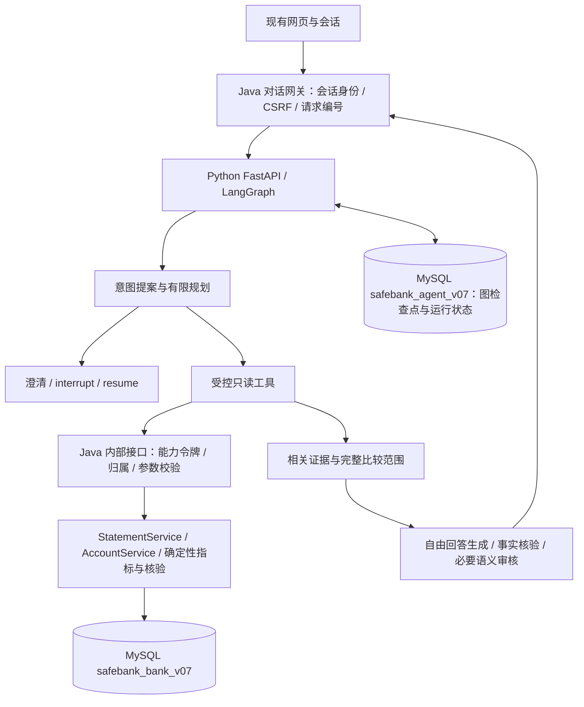

# SafeBank v0.7：Python LangGraph 与 MySQL 首阶段设计

评审修订版（2026-10-10）：依据外部评审核查后补全依赖预验证、副作用记录、版本与确认、对账和能力续签契约。处理结果见[评审处理与风险索引](../../2026-10-10-v07设计评审处理.md)，第10节为恢复一致性的规范；本轮仍仅改设计。

2026-10-10。状态：修订设计与预验证方向已获用户确认，同步假图实验已完成；正式业务实现尚未开始，M1实施计划待审阅。依赖只安装于忽略的实验虚拟环境，未更改产品pom或运行库。基线 `ed84c67`；新分支 `feature/v0.7-python-langgraph-mysql`。用户确定 MySQL，并要求保留原版本继续开发；此前讨论确立 Python 官方 LangGraph 负责 Agent，Java 保留 MyBatis 和银行执行。

## 1. 目的、首阶段范围与保留版本

目的：结合客户具体问题灵活使用真实查询依据，改善多轮追问；采用官方 LangGraph 管理可观察、可恢复的 Agent 状态，避免重写已验证的银行安全执行层。团队四人，其中一位 Java 主力；模型费用受控。日投入未确认，不承诺固定工期。

首阶段交付仅包含：MySQL 隔离合成候选、Python Agent 服务、Java 对话网关及只读工具接口、账单总览/大额追问/月份比较/缺参澄清/改口/重启恢复、原网页对话响应兼容。真实登录、MFA、外部银行仍未接入。跨场景资金 DAG、撤销/转账执行和新的网页视觉改版放在后续阶段，不让首阶段扩大成整套重写。

- 原 v0.5 主目录及 8096 不修改、不重启、不换数据库。
- v0.6 分支/目录及原候选 8110/8111 保留，不修改已启动产物。
- `archive/v06-before-python-mysql` 固定到 `ed84c67`，可找回迁移前全部已提交代码；忽略的密钥、运行库、target 不属于 Git 快照。本阶段不移动、清理或覆盖它们。
- 新目录 `.worktrees/v07-python-langgraph-mysql`；拟用 Java 8130、Python 8131、候选 MySQL 3307。实际启动前检查占用，不杀其他进程或替换现有 MySQL。只绑定 loopback，迁移前不开放公网。
- 新候选默认只使用版本化合成数据；不从原文件库或内存实例自动抽取、删除或导入。未来迁移旧文件数据另有副本核对和回执保护步骤。

## 2. 架构与路径

采用一个 Java 业务服务和一个 Python Agent 服务，均在同一仓库中。现有 Java 源码目录不整体搬家；新增 `agent-python/`，内部按 API、graph、model、tools、evidence、persistence 分包，有实际职责才拆文件。

Java 是浏览器唯一入口，Python 无网页会话 Cookie，不能接受浏览器任意 userId 决定银行归属。Java 网关调用 Python 不持数据库事务；Python 回调 Java 工具不要求持有浏览器 HttpSession 锁。

首阶段通过固定启动配置 `native` / `python` 选择 Agent 路径，新候选采用 python，原路径仍可在单独候选启动时作对照。供应商失败不自动切回 native 重发同一请求，避免重复调用和状态不一致。原 8096/8110 始终提供旧体验。

LangGraph 状态图允许有限回答修正循环，`interrupt` 保存澄清等待。首阶段没有银行写入工具。后续业务计划 DAG 必须另外有明确依赖边、白名单节点和无环校验，不能把普通对话图宣称为已完成跨场景 DAG。

## 3. 状态所有权与既有上下文

| 状态 | 唯一权威位置 | 复用方式 |
|---|---|---|
| 可信用户、银行对象、授权与交易终态 | Java 业务服务与 bank 数据库 | 原 Service/MyBatis、风险与执行代码保留 |
| python 路径的意图、缺参、用户改口、消息窗口、节点位置 | Python graph state 与 checkpointer | 迁移相关提示词和参数来源概念；不再让原 ContextAgentCoordinator 推导此路径的意图 |
| 浏览器会话归属、外部请求幂等、展示历史和银行证据 | Java 现有四表上下文 | ContextService 收敛为网关与证据支撑；原 native 路径的槽位行为保留 |
| 单轮运行、执行租约、展示事件、模型用量 | Python 应用表 | 与 Java conversationId/turnId/requestId 对应 |
| 旧 workflows/workflow_steps | Java | 首阶段保留，只读图不迁移该联合执行流程 |

四表原样保留，但 python 模式下不能再由 Java 正则或 ThreadLocal 独立维护第二份模型决策状态。图 checkpoint 存必要证据引用/快照摘要、来源时间和版本，不存调用令牌、API key、Cookie 或 OTP。余额和实时权限每次仍以授权查询结果为准。

每个 graph thread 关联 Java 已核验归属的 conversation。Python thread ID 由服务生成，浏览器不能单独指定别人的 thread；resume 必须经 Java 验证该 conversation 归属和 expectedContextVersion。参数来源沿用 USER_EXPLICIT / MODEL_PROPOSED / BANK_CONFIRMED，模型提案不能自动变成用户明确选择。

## 4. 跨服务接口与身份契约

浏览器保持 `POST /api/chat`、现有 ChatRequestDTO 字段、会话/CSRF 与 code/message 错误形式。新增状态字段可兼容扩展；旧 answer/toolResults/clarification/上下文版本等实际响应字段以当前源码和本地合同样本冻结，不任意更名或全局加包装。

| 接口 | 调用者 | 契约 |
|---|---|---|
| Python `POST /internal/agent/turns` | Java 网关 | 受服务认证保护；带可信 userId、conversationId、turnId、requestId、expectedVersion、文本和只读能力令牌引用；返回已核验回答、工具展示结果、事件与上下文版本 |
| Python `GET /internal/agent/turns/{turnId}` | Java 网关 | 按可信归属读取运行状态；网关超时或崩溃后查原轮，不创建新 requestId 重发 |
| Java `POST /internal/agent/tools` | Python | 工具名与明确类型输入；只接受 statement、statement_compare、recurring_analysis、account_query；令牌限定本轮与用户；查询结果含原金额单位、范围、观察时间与证据编号 |
| Java `POST /internal/agent/answers/validate` | Python | candidateAnswer、已登记 evidenceIds 与结构化计算引用；复用程序事实核验，返回明确 violations，不调用模型 |
| Python resume | Java 网关，由原 chat 请求承接补参 | 只恢复本会话当前等待节点；版本冲突、已完成轮或过期会话拒绝；本阶段无通用资金批准入口 |

内部服务认证采用部署环境中的高熵共享服务凭证，双端验证，凭证不进入模型、网页、日志或 Git。生产远程部署时须使用 TLS；本阶段 loopback 仅用于合成演示，不称为真实登录安全方案。

银行回调另需 Java 签发的短期、可撤销、只读能力令牌：随机至少 256 位，数据库只存 token_hash，绑定 user/conversation/turn/request、固定工具 scope、失效时间及最大调用次数。令牌原文只通过服务请求传递，不进入 checkpoint；服务恢复若令牌已过期，必须向 Java 重新核验原轮再签发，而不是保存永久凭证。

Java 内部接口不通过 SessionGuard 的浏览器会话机制伪造 Cookie：配置独立严格内部认证链，仅排除具体内部路径，默认拒绝其他工具/模型提出的写入、authorize、submit。工具输入无 userId 授权字段，实际归属从令牌行获取。请求大小、month 格式、范围和工具数均有上限。Java→Python 服务凭证不能作为银行资金授权。

同 conversation 同时仅一个运行；前端重复 requestId 返回已保存结果或明确处理中，不同内容复用同编号拒绝。Java begin/complete 与 Python run/checkpoint 非同一事务；失败记录使用原 turnId，通过查询原 run 修复完成状态，不把网络超时直接断言为 Python 未执行。

## 5. 数据库先行设计

配套 [MySQL 首阶段数据库设计](../../database/2026-10-10-mysql-v07-design.md)盘点 24 张已有表、26 张目标银行表（含内部能力令牌与工具幂等回执）及 Python 应用表。DDL 与 Java 类型实现必须遵循该设计；最终可执行迁移脚本属于后续实施，不在原库试跑。应用表开发前先完成[检查点兼容预验证](2026-10-10-mysql-checkpointer-spike.md)，只创建可抛弃的专用检查点实验库。

拟选 MySQL 8.4 系列 InnoDB，精确 patch 在离线环境验证后锁定；Python 3.12 为目标环境。官方 LangGraph + 社区 `langgraph-checkpoint-mysql` 已发布 3.0.0 为适配候选，最终 LangGraph/driver/FastAPI/serializer 版本以首次兼容验证的锁文件为准，不假定当前最新版可以任意组合。不能默默改成 PostgreSQL。

使用两个独立 database：`safebank_bank_v07` 与 `safebank_agent_v07`。Java 账号只访问 bank，Python 账号只访问 agent；迁移账号独立，运行账号无 DDL 权限。Java 迁移用 Flyway 精确版本化脚本；checkpointer 自有迁移按固定实现执行一次 setup 并核查表与索引，不能让每次请求用管理员账号建表。

H2 与 MySQL 环境均有独立 profile。新 mysql profile 禁止 spring.sql.init 反复运行原 H2 schema；原风险/上下文 initializer 在该 profile 不创建 H2 方言结构，改由迁移完整建立并在启动核验。H2 原测试路径保留，新 MySQL 验证必须连接真实 MySQL，不用 H2 MySQL mode 替代行锁和约束验证。

## 6. 回答、规划与费用控制

复用历史问题与失败样本，保留程序确定性金额计算和事实校验；不直接将 GroundedAnswer 整类翻译到 Python。Java 计算总额、类别、排名、差额、比例及完整比较范围；Python 提供更聚焦的证据给模型组织解释。核验需要的完整类别不能因精简输入被删除。

首阶段路由包含总览、单笔/大额聚焦、跨月比较、澄清和超范围说明；由结构化模型提案控制查询，Java 校验查询参数。正常回答要求 answer_customer 类结构化草稿及事实引用，最终展示自然语言而非预置业务答案。结构化成功不等于业务正确。程序核验失败允许最多一次有具体原因的修正；仍失败时用聚焦本问题的安全解释与事实展示，并明确不足。

只读语义审核沿用既有风险维度和样本，不宣称与生成模型独立。金融分析候选通过程序核验后才做必要语义审核；费用预算不足返回明确预算状态，不为了完成审核额外发送。

硬预算在实际 HTTP 发送前预留：生成、规划、修正、审核全部计数；关闭 SDK 和 graph 隐式模型重试。失败不退额。单轮上限 5 次，规划/生成/必要审核在统一上限内分配；客户端只可降低，不能提高。保存供应商 response id/实际 model/usage 缓存字段和计数，禁止原始密钥或隐式思维链进入日志。

已存在的共享调试账本继续用 `20261010-v06-context`，当前已预留 11/20；本轮不读取密钥或调用模型。Java为该账本唯一写入方，Python通过严格内部服务认证调用预留/记录接口，不直接写文件。Java扩展幂等reserve(operationKey)：同key与输入哈希只能获得同一个reservation，且原native路径的随机ID预留仍计入同一20次；文件中保留已有记录，附加字段兼容旧读取逻辑。Python只有收到成功预留才可进行一次实际HTTP发送；拿到原reservation不等于允许重发。通信超时可查询同key状态，不能另起key重试。数据库usage表只作观测，不能另起预算。先用假模型本地验证第21次不得发送，再少量真模型验证；恢复具体规则见第10节。

## 7. 运行、恢复与错误语义

Python 以 FastAPI 提供非流式首阶段契约，LangGraph 状态包括 schemaVersion、conversation/turn/request、contextVersion、意图、参数来源、证据引用、节点进度、调用预算和等待信息。同会话运行采用有到期时间、fencing revision 的数据库租约；旧进程失去租约不得保存完成状态或继续发送模型请求。

进程重启能恢复已持久化澄清等待；正在模型 HTTP 中断的轮标为需要核对，不默认重放收费节点。能力令牌不在图持久化，需经 Java 核验补发。原展示历史和 bank 证据保留。checkpointer 存储格式升级必须有显式 schemaVersion/迁移，禁止随意用 pickle 反序列化不可信数据。

错误区分服务不可达、权限拒绝、版本冲突、正在处理、供应商失败、预算耗尽、证据不足、回答核验失败。Python API 超时后 Java 返回可查询原请求的状态，浏览器提示重取原轮；不能把通用“已返回工具结果”当完整回答。状态事件只展示已实际发生的查询和核验，不向用户展示未核验模型数字或成功声明。

## 8. 有限验收与实施门槛

| 验收 | 最低要求 |
|---|---|
| 旧版保护 | 原分支/目录存在且无源改动；新服务、端口、库和凭证独立，原入口不切换 |
| MySQL 迁移 | 一次合成初始化、二次启动不重复种子；24表语义、所有授权哈希、整数分和时间转换核对；新增 grant / tool receipt 表按设计建立，列级diff逐项解释 |
| Java 关键行为 | MySQL 实际约束/事务/锁检查；授权/原动作/借贷平衡/额度跨日的既有关键断言保留，H2通过不能代替MySQL结论 |
| 服务接口 | 非法/过期令牌、换用户/会话、越scope、任意写工具、超量请求被拒；无浏览器Cookie被转发 |
| 图恢复 | 缺月→暂停→重启→补月恢复；同 request重放、改口版本、租约过期与旧实例写入被覆盖；checkpoint saver实际持久化 |
| 回答聚焦 | September总览、大额追问、August/September比较、退款口径、缺参、越范围六组离线用例各有明确预期；模型自由回答另标真实联调结论 |
| 预算 | 真实发送前预留，失败计数，SDK无隐藏重试，额度未清零；记录每题请求与Token，不只看测试数 |

文档阶段只验证完整性和本地链接，不安装依赖或重跑完整270项。实施按阶段跑必要检查；每个阶段达到交付点就停止扩大。既有真实模型样本不能冒充迁移后质量验收。

书面设计经用户审阅后才形成逐文件实施计划。建议实施顺序为：有时间盒的检查点预验证 → 新候选MySQL迁移 → Java受控只读工具与网关 → Python图与状态 → 回答核验/预算 → 原网页合同与有限验收。预验证失败按第10节Plan B处理，不顺带换库或扩大基础设施。

## 9. 已核查的外部依据

- [MySQL 8.4 日期类型](https://dev.mysql.com/doc/refman/8.4/en/datetime.html)：MySQL 时间类型与 H2 TIMESTAMP WITH TIME ZONE 不同；数据语义需要明确转换。
- [MySQL 检查点包](https://pypi.org/project/langgraph-checkpoint-mysql/)：社区实现，已发布3.0.0；支持同步/异步driver，要求MySQL>=8.0.19，setup/autocommit 有明确要求；存在实现不是本项目兼容通过。
- [LangGraph 中断](https://docs.langchain.com/oss/python/langgraph/interrupts)：节点恢复可能重跑，必须处理副作用与幂等。

本文件是 v0.7 首阶段设计，后续撤销/转账/储蓄 DAG 需单独设计其授权与副作用恢复；目前没有新增生产功能或迁移任何运行数据。

## 10. 评审补充：恢复、费用和版本的一致性

### 10.1 检查点风险与 Plan B

应用DDL和业务骨架之前，预验证采用假图/假供应商、MySQL专用实验库，累计4小时有效工作为上限，最多一次明确定位后的修复复测。先验证同步 PyMySQLSaver，不因同步可行就同时开发异步图；异步不是首阶段硬需求。1–2天可作为团队安排窗口，但不是未知人力条件下的交付承诺。

Plan B选同MySQL的最小同步checkpointer适配：仅当失败能定位到可界定的API/serializer差异，优先在项目Adapter内兼容；若必须自研BaseCheckpointSaver，则先提交范围与契约设计，并使用官方conformance检查和实际重启恢复验证，不能直接在业务开发中补一个未验证saver。预算时间盒用完即保存原因与可复现用例，原native候选继续可用。SQLite、内存Saver和无checkpoint状态机不作为正式交付替代；任何扩大到自研Saver的工作另行审阅。本轮仅确定风险处置，不执行spike。

### 10.2 操作编号与节点重放

interrupt节点只产生澄清等待和接收补参，不包含模型HTTP或银行工具调用；规划/工具/生成/审核各在独立节点。模型、工具都经持久化effect wrapper。稳定operationKey由会话、原java_turn_id、固定节点、逻辑调用序号和输入规范哈希组成；在发送前写入，不以lease revision或恢复后的新run_id重新生成。正常补参新轮的新输入生成新key；恢复旧节点则沿用旧key。模型计划输入不得自行指定可信操作编号。

Python `agent_effect_receipts`保存operationKey、原轮、purpose、输入哈希、状态与可复用结果。状态为PREPARED / SENDING / SUCCEEDED / FAILED / UNKNOWN；状态转换需持有效租约并CAS，外部发送不持DB事务。SUCCEEDED且哈希相同直接读取保存结果，不新增预留或发送。相同key不同输入拒绝。FAILED也不自动重试；明确的回答修正是新的逻辑调用，使用新key并扣预算。

模型发送前先取得Java幂等预算预留，再原子标为SENDING后进行单次HTTP；回复持久化为SUCCEEDED后才提交节点输出。预留后崩溃可能浪费一个预留，失败不退额。若SENDING后崩溃，即使可能还没送达也按UNKNOWN保守处理；不自动重发、不伪造usage、不宣称供应商未收费。用户明确要求新尝试时新requestId/key继续消耗原账本余额，并显示旧结果未知。已经有完整响应但图checkpoint未保存，可通过effect回执复用；任何无法判断是否发出的请求保持暂停。

Java工具接口必须传operationKey与inputHash，并在bank库的agent_tool_call_receipts按turn/key保存查询快照。验证当前归属/新有效grant后查原receipt，命中不重复查询、不重复占quota；其观察时间仍是原快照，不冒充实时数据。需要刷新事实则新的逻辑调用、新key和配额。工具额度与模型额度分开计数。Java工具事务内锁turn，核验版本/grant和总配额、消费一次quota、保存结果，失败回滚；首阶段工具限本地DB查询，没有外部银行网络或LLM。Python回调结果未知时可以按相同key查询Java已提交receipt，不通过新key放大查询。

验收口径是“已持久化结果重放不新增发送/计数；发送结果未知不自动重发”，不是外部供应商端exactly-once或永不重复计费。[LangGraph中断说明](https://docs.langchain.com/oss/python/langgraph/interrupts)解释恢复时节点前段重跑；checkpointer本身不能替代上述effect契约。

### 10.3 唯一版本权威与两步完成

Java `agent_conversations.version`是唯一业务contextVersion。`ContextService.begin`锁会话并校验expectedVersion；`complete`现有CAS成功后加1。reset/expire也由Java递增；失败轮不默认递增。Python schemaVersion只标状态格式，input_version是Java输入版本投影，output_version只有拿到Java完成ACK才能填值，不由Python独立+1。

Python先保存不可变result、resultHash与state=RESULT_READY，Java读取校验后按原java_turn_id/输入版本幂等complete（成功或澄清均作为本轮已完成响应），在同一事务保存展示结果、证据与v+1。Java返回ACK(原turnId,outputVersion,resultHash)，Python再CAS填output_version并标COMPLETED或NEEDS_CLARIFICATION。ACK丢失时对账重取Java原回执，不再运行模型或再次加版本。重复complete且同hash返回原结果，不同hash拒绝并进入人工核对；该幂等接口需新增，不能声称旧complete已具有此行为。

补参新requestId由Java在v+1核验并begin；resume同时验证上一轮等待的已确认版本、thread关联、interrupt编号和当前Java版本。旧schemaVersion不能当业务版本；Javareset/改口导致旧等待失效时，服务停止恢复该interrupt并按新版本重建当前提案，保留原记录。Python没有ACK时不接受同thread下一轮，先对账。

### 10.4 对账、超时回收与人工介入

Java python模式不得沿用ContextRecoveryService启动时全局interruptProcessing；改为仅处理本实例/已失效租约对应轮，并查询Python原run。Java网关维护进程内调度器每30秒扫描有界批次100条PROCESSING、未ACK和显式待对账轮；Python每30秒扫描到期PROCESSING租约。调度可重复，写入CAS防多实例重复完成，不持事务等待跨服务HTTP。

| 状态差异 | 修复动作 |
|---|---|
| Python RESULT_READY、Java PROCESSING | 按resultHash/输入版本完成Java原轮，再补ACK，不调用模型 |
| Java COMPLETED、Python RESULT_READY | 重取Java保存outputVersion与hash，匹配则ACK；冲突则暂停/人工核对 |
| Java COMPLETED、Python FAILED/UNKNOWN或无run | 冻结后续该会话，不自动回退或重建成功，记录RECONCILIATION_REQUIRED |
| Python PROCESSING租约到期 | 检查effect/checkpoint；有SENDING模型effect→UNKNOWN暂停；纯本地已完成结果可恢复；不自动重新请求模型 |
| Java PROCESSING、Python无run | 服务可达且确认无run时，标原轮INTERRUPTED，不猜测曾无收费；如需新尝试由新用户请求发起 |
| Python NEEDS_CLARIFICATION且Java已ACK | 正常等待，不按长任务超时回收 |

跨服务查询不可达不认定无run，保持可观察的处理中/待对账；连续3轮失败仅触发本地告警，停止自动修复，不重试模型。人工入口首阶段为只读状态查询和有记录的核对操作，不能直接改交易表。运维指标至少有expired_lease、pending_ack、reconciliation_failure、model_budget_rejected、model_effect_unknown计数及最老等待时间；首阶段用本地结构化日志/状态页，不额外部署整套监控集群。

### 10.5 能力续签、配额和验收单位

agent_service_grants与agent_tool_call_receipts明确位于safebank_bank_v07。续签事务锁原agent_turn_receipts行，先核验归属/原轮仍可运行/当前版本；撤销旧ACTIVE并插入新token_hash须同一事务。已用额度取原轮唯一receipt数而非新grant的零计数，所有新调用也锁同turn检查，旧grant已撤销后不可再消费。续签不延续越版本的权限，不扩大scope和原轮总quota；原calls_used列只为单grant观测，不能成为跨续签权威计数。

模型5次上限按每个Java受理的java_turn_id计。补参是新的用户请求，可有自己的最多5次，但必须是Java接受的新轮；内部resume、节点重放、SDK重试不产生新轮。全体调试仍共享20次总预留且已11次，补参不能绕过它。Java预留接口按operationKey记录原java_turn_id和purpose，原轮上限及总余额一起核验。银行查询不计模型请求；两个月查询本身是2次工具调用，不必是2次模型调用。局部预算不足不能为了审核或澄清突破上限。

增加离线验收：同key预留重试、两次grant并发续签、interrupt重启后结果复用、SENDING崩溃无重发、ACK丢失只增一次版本、reset拒旧resume、3次对账不可达告警和恢复后再核对、补参新轮与总预算仍一致。上述均是设计要求，尚未验证。
