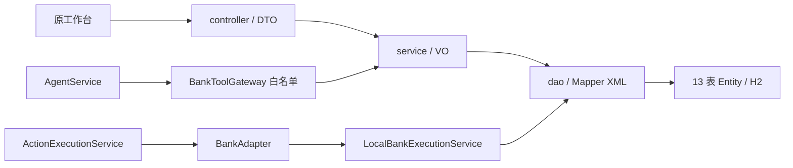

# MyBatis 分层迁移验收（2026-10-08）

队友审核通过后，已于 2026-10-08 本地快进合并到 `feature/v0.4.1-business-reliability`。合并后在主工作目录运行 `./run.ps1 test`：164 项、0 失败/错误、1 付费联调跳过。没有远程仓库，未执行 pull/push。工作树 `.worktrees/mybatis` 暂保留，因 8095 候选服务及其运行 JAR、验收截图仍位于其中；停用或迁移该服务后再清理。原在线服务尚未切换，新代码已在主工作目录可供团队继续开发。

候选分支 `feature/mybatis-layered`，基线 `44293ce`，工作树 `.worktrees/mybatis`。这次实现用户批准的完整迁移，保留合成银行、逐动作授权、未知状态恢复、模型自由回答及预算机制。数据库设计已先冻结；现行 schema/data 不变。

## 实际结构

10 个控制器按会话、账户、账单、代扣、动作、计划、审计、模拟、联合任务和聊天拆分。12 个服务（含转账校验服务）承担决策与短事务；13 个 Mapper/Entity 对应 accounts、recipients、transactions、mandates、actions、ledger、schedules、occurrences、audit、execution_observations、bank_faults、workflows、workflow_steps。查询投影单独放 dao/projection。

DTO 是输入，Entity 是持久化记录，VO 是展示结果；Mapper XML 存放 SQL。删除生产 BankService、旧执行和任务适配、旧 API Controller、Map 继承回执和临时转换器。旧测试的 JSON 比较助手只存在 src/test，运行包不包含。

## 已核验

- 账户/账单/动作/任务原公开字段、日期、null 与扁平参数；银行响应 snake_case，任务响应 camelCase。
- CSRF、跨用户来源/收款人/动作与工具权限；模型只能查询和预览，不能授权或提交。
- 整数分与退款/内部转账口径；预览不动资金，双边分录守恒，重复提交不重复记账，故障事务回滚。
- UNKNOWN 查原动作、明确未受理才可原动作重试；真实临时 H2 文件关闭重开能恢复丢失响应。
- 不同调度实例并发同一期只建一个 occurrence、一个动作；任务版本拒绝旧输入，已核验月度节省不会重复累计。
- 非规范空白/键序的旧 payload 直接入库，重开后原字符串和哈希不变；旧授权继续执行，文件再次重开余额与任务版本保持。
- 本地模型 HTTP/脚本客户端回归保留事实缓存、问题焦点、回答审核和请求预算；本轮真实 DeepSeek 请求 0。

## 最终运行结果

修复已提交为 `7552f0e`。最终全量回归为 164 项，163 通过、1 项付费联调跳过、0 失败/错误。全量通过后以 `-DskipTests package` 重新生成 JAR，避免再重复执行同一套测试；构建成功。

| 检查 | 实际结果 |
|---|---|
| 修复后相关回归 | 15/15 通过；三个新增回归均先复现真实错误再通过 |
| 修复后 Java 全量 | 164 项，0 失败/错误，1 付费联调跳过 |
| 修复后打包 | BUILD SUCCESS；已通过全量测试，再打包跳过重复测试 |
| 最终运行候选 | 8095、PID 31392、OFFLINE_DEMO；运行 JAR 与最终构建 SHA-256 一致；修复后四宽度浏览器回归再次通过 |
| 修复前 Java 全量与 package | 161 项，0 失败/错误，1 付费联调跳过，JAR 构建成功 |
| 文件旧格式兼容 | 真实临时 H2 文件三次打开，原 payload/hash、余额、分录、任务步骤与版本保持 |
| Python evaluator | 4/4 通过，不发请求 |
| 浏览器 | 实际 8095 页面，1440/390/768/1024 四宽度；导航、中文输入法、Shift+Enter、失败重试、刷新失败不重发；4 次聊天拦截桩、0 真实模型请求 |
| 运行包检查 | 13 Entity/13 Mapper XML，旧生产入口和测试适配器不在 JAR 内 |
| 源码边界 | 生产直接 JDBC/SqlSession 命中 0；Controller 不注入 Mapper；Service SQL 字面量命中 0；疑似密钥内容命中 0 |

历史关闭快照 `data/v02-final-8084-1348.mv.db`：独占只读打开源文件后复制到候选 target，再用 `ACCESS_MODE_DATA=r;IFEXISTS=TRUE` 只读查询；复制前后内容哈希一致。13 表行数：账户 5、收款人 3、交易 7、代扣 2、动作 3、分录 0、计划 1、期次 0、审计 9、执行观察 3、故障 1、任务 1、步骤 3。余额：checking 1,243,000 分、travel 5,820,000 分、other 100,000 分、两外部账户均 0。此证据来自历史关闭快照，并非当前在线库。

## 一次独立审查与修复

审查范围 `44293ce..20df3a8` 加 Task 8 未提交文件；审查进程曾被 Codex 额度限制中断，用户要求继续后恢复同一次审查。审查只读，不调用供应商，无第二轮复审。结论：无 Critical，3 项 Important，无单列 Minor。

1. 定时余额不足的两次并发请求都读到 AUTHORIZED 后，第二次失败落库会冲突。新增屏障控制真实数据库交错，先复现冲突；动作锁内失败记录复用已有终态，保留原回执和错误、只写一次拒绝审计。
2. 旧流水 category=NULL 时 TreeMap 汇总失败。先复现 NPE；汇总桶恢复空字符串，流水自身仍保留 null，收入支出与大额候选口径不变。
3. 非活动旧计划 amount_minor/day_of_month=NULL 被查询 VO 强制拆箱。先复现 NPE；VO 改用 Long/Integer，保留公开 null，取消计划不会产生执行动作。

覆盖测试：`MyBatisMigrationRegressionTest`。首次屏障也拦截了 prepare 内部读，测试因计划锁超时失败；定位后只在期次已持久化后的失败读处同步，再运行确认三项都按上述真实原因失败。测试构造修正没有改变生产代码。

审查划定的后续边界：真实供应商语义、在线库切换、储蓄目标必须本人账户的增强、多进程远程提交仲裁、冻结 schema 约束/索引与原本非法活动记录。本轮保留旧行为，下方决议列出代价。

## 交付与边界

候选页面端口 8095 使用独立内存库和空模型密钥，为离线工具演示；聊天回归拦截四次请求，不能证明真实模型语义。原 8092/8093/8094 服务与库不替换、不并发写同一文件。本轮不推送、不公网部署、不提交比赛。

正式切换：先确认候选，通过登记 PID/启动时间识别并停止旧服务，一致备份旧 jar/文件库，再单实例启动新版；核对余额、历史动作与任务恢复。表结构冻结，回退可使用旧 jar，数据库不删除。红蓝 UI 及滚动显现仍是独立待审核方案。

## 执行决议与偏差

| 决议（按执行顺序） | 代价与后续核验 |
|---|---|
| Windows 无 Bash 技能辅助脚本，改用 PowerShell 维护任务账本 | 辅助流程需人工核对 |
| 依赖下载使用临时官方 Central 镜像配置，不提交仓库配置 | 换机器需正常依赖下载网络 |
| 依赖插件未缓存，改核对 Surefire 实际运行 classpath 的唯一 MyBatis 版本 | 不等同完整 dependency:tree 输出 |
| 生成助手显式 UTF-8，编码中断已修正；迁移阶段暂保留旧成功账务验证 | 其他机器生成脚本需保留编码配置；最终已迁移分录验证 |
| 重启测试改构造新执行协调器与阶段性适配器，保持新实例恢复断言 | 旧断言需结合新的类型化/HTTP 测试核验 |
| 计划意图/期次与本地资金执行分开短事务；空 pendingAction 使用类型化序列化保持 {} | 将来远程定时适配须重新核对事务/受理边界 |
| 旧 JSON 断言保留仅测试用转换助手，生产全部移除；新测试直测 typed/HTTP | 测试转换可能遮蔽字段问题，已增加 HTTP 精确字段断言 |
| 禁止工具继续返回既有 PERMISSION_DENIED | 客户端继续处理原权限错误码 |
| 文件兼容用例首跑已通过，不为制造失败修改产品 | 未覆盖的历史畸形数据仍需团队核查 |
| 候选使用空密钥、独立 8095 内存库，原在线实例保持；只核对关闭快照 | 当前在线数据正式切换仍需一致备份后验证 |
| 无可用 Browser 插件工具，使用现有 Playwright/Edge，聊天拦截 | 不能证明真实模型回答或供应商行为 |
| 保留本地协议/回答/预算回归，本轮不做付费语义联调 | 真实语义/网络行为需团队另设调用预算 |
| 批准候选前不切换在线文件库或执行回退 | 正式切换时仍要核验原在线数据 |
| 储蓄任务可选择本人联系人指向外部账户是基线行为，列后续增强 | 当前储蓄目标可能是外部账户，用户需核对目标 |
| 保留独占 H2 文件库与本地银行范围，不加入分布式远程提交仲裁 | 多进程远程银行适配前需数据库级提交仲裁 |
| schema 约束/索引与原有非法活动记录留后续迁移，本次修复新引入空值查询回归 | 畸形活动计划仍可能失败，需独立校验与数据治理 |
| 最终全量测试通过后用 -DskipTests 打包，避免再次执行同一测试集 | 测试与打包之间不得改生产代码；已核对运行包哈希 |
| Windows 端口查询需提权；Stop-Process 内部错误后改用 .NET API，仅终止已核对 PID/启动时间/JAR 的本轮候选 | 不适用于任意服务；仍按登记身份核对，保留旧候选 JAR |

延后 Minor：无。全部实质迁移回归在本轮修复；上述基线行为和部署边界是明确保留的决议。
