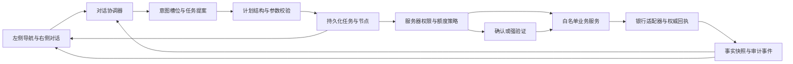

# SafeBank 赛题对齐与开源借鉴方案

2026-10-09。研究基线 `f9b01ee`，生产候选仍为 `0f93f85`。本轮阅读团队提供的往届经验、赛题分析，核查原始仓库/官方文档并检查本项目源码；不修改生产功能、不启动新框架、不调用 DeepSeek、不重跑全套测试。本文为技术学习结果与下一阶段设计建议，不代表功能已实现。

## 1. 材料如何使用

输入：[往届经验](../../往届经验.md)、[赛题分析](../../赛题分析.md)。赛题分析按团队提供的官方材料作为当前需求依据；原始附件、版本和最终评测接口仍需保留。不要继续把其中已经明确的三级权限、材料规格当作“完全未知”。

往届经验提供的是技术栈及开源资源清单，没有逐项给出获奖作品名称、年份、名次和官方名单；不能据此认定所列仓库均为获奖作品或均已达到生产可用标准。secure-banking-core / fincore-banking / nexapay 未提供明确仓库地址，本文不臆测同名仓库。项目数量、星数和自称生产级都不是我们的验收依据。

资料中的“FATE-LLM 是本赛题官方指定技术体系”“联邦学习是典型获奖路径”“某框架最成熟”等判断尚无相应赛题或获奖证据。FATE-LLM 官方定位是联邦大/小模型学习框架，不能由出品关联推出本赛题必须使用。[官方仓库](https://github.com/FederatedAI/FATE-LLM)

三个重点银行/工程参考的独立核查见[原始仓库核查](2026-10-09-参考项目原始仓库核查.md)。下文明确区分已核验能力、设计借鉴、尚未运行的适配方案。

需要校正的具体项：FinSight README 列 Java 17 / Spring Boot 3.3.5 / JDBC，与资料的 Java 21 描述不同；Azure main 支持监督 Agent 加三个专门 Agent，票据扫描是工具，不据此凑“五 Agent”。FinSight 与 Azure 的 MIT 标识已从仓库元数据确认，但许可证正文未完整取得，尚不满足实际复制前的许可核对。源码机制存在也不等于经过我们构建或生产验证。[FinSight 原仓库](https://github.com/juanjuandog/FinSight-AI)、[Azure 原仓库](https://github.com/Azure-Samples/agent-openai-java-banking-assistant)

## 2. 赛题和当前代码的差距

当前有用的资产应保留：Java 21 / Spring Boot / MyBatis 分层、银行适配器、工具白名单、整数分计算、参数哈希授权、动作幂等、UNKNOWN 查原动作、联合任务版本与证据快照。当前不足主要是赛题能力和产品连贯性，不需要从零重写。

| 材料要求 | 当前证据 | 缺口及优先级 |
|---|---|---|
| 至少三个场景 | 账单、转账、代扣有真实合成业务；定时储蓄/联合任务已有 | 三个方向成立，但不能声称每项示例均覆盖；AA、年度报告等尚缺。主线保持三场景，跨场景作为特色 |
| 绿色自动、黄色确认、红色强验证 | 工具查询自动；ActionService 所有写动作同一种确认；AuthorizationRequestDTO 仅 demoVerificationAccepted | **P0：缺少服务器三级权限与强验证**，模拟勾选不是多因子验证 |
| 日累计 ≤1000 / >1000 元 | TransferValidationService 仅单笔 10,000 元演示限额 | **P0：单笔限额不能替代日累计判定**；两次600元和并发请求都应升级验证 |
| 模糊表达、上下文与规划 | AgentService 工具循环、HttpSession 对话及证据；收款人支持姓名/手机号/备注精确匹配 | **P1：意图槽位、待澄清项、任务状态缺少明确持久化模型**；模糊匹配不能自动猜同名收款人 |
| 子任务 DAG、中断/回退/接管 | WorkflowService 有固定撤销→储蓄状态流程、版本与取消 | **P1：已有可恢复流程可复用，但未形成声明式依赖图和受约束的自然语言规划**；已执行转账不能承诺直接回滚 |
| 完整决策及执行审计 | audit 保存 action_id/event/time；模型用量在日志/本轮响应；trace 主要是字符串 | **P0/P1：缺少贯通请求、任务、节点、证据、策略判定、确认和回执的关联记录** |
| 连续失败/可疑行为安全锁定 | 有请求次数、轮数、工具数和超时上限 | **P0：调用预算不是行为熔断**；需按用户/会话/工具维护失败与锁定状态 |
| 幻觉与注入防护 | GroundedAnswer、只读语义审核、白名单、参数验证、授权及银行回执 | 已有基础，保留；真实回答质量尚有未完成验收，进入后续有预算的验证，不扩大本轮测试 |
| 受限生成代码执行 | 未向模型开放通用 shell/SQL/Java 执行；计算走受控工具 | 不把“不执行任意代码”称“已实现代码沙箱”；若必须执行代码，独立无银行写权限沙箱再评估 |
| APP/IM 等渠道 | 当前 Web | 根据原始要求确认 Web 是否满足，保留渠道适配接口，必要时只增加一个渠道 |
| 提交材料 | README 和本地验收/脚本已有，无Git远端 | 补200字简介、架构/算法/安全文档、≤10分钟答辩、≤5分钟视频、部署/用例/GitHub地址、安全自评；实际发布另行执行 |

材料“订阅查询/取消”列在黄色，另一处纯查询属绿色，存在需要明确的边界。建议规则单独配置，暂按材料具体条目保守处理，不自行把取消降为自动，也不声称组委会已同意我们的解释。

## 3. 原始项目中真正值得吸收的部分

| 参考 | 已核验/学习入口 | 在 SafeBank 的用途 | 采用方式 |
|---|---|---|---|
| AgentScope Java | 官方工具权限、确认/恢复事件；PermissionDecision.java 可读 | 权限判定与工具执行分离，结构化进度事件，人机暂停恢复 | 先吸收接口设计；框架是否接入另做小范围适配，不移交账务权限 |
| Agents-Flex | 官方 MCP 文档展示 Tool Schema→Tool、标准工具闭环及生命周期 | 工具描述按需加载、插件式外部能力接入 | 官方文档也建议稳定本地能力直接建 Tool；目前保留 BankToolGateway，MCP 在跨系统接入时采用 |
| FinRobot | 最新 README 区分 V0/V1/V2；旧 workflow.py 与当前 auth.py 可读 | 确定性计算、证据与报告分离；角色职责与工作区设计 | 借鉴报告及职责，不搬 Python 投研平台，也不照搬旧示例执行代码的默认值 |
| FATE-LLM | 官方联邦学习定位与许可证 | 后续确有多方私有数据训练时再评估 | 本阶段不加微调、联邦训练或相关基础设施 |
| Azure 银行示例 / FinSight-AI | 见独立核查中的具体文件与链接 | 领域工具划分、长任务恢复、调用合并及快照版本 | 优先吸收能直接改善银行任务的模块，逐项记录适配与出处 |
| finogeeks/FinClaw | 见独立核查的访问状态 | 只保留待核验资源项 | 无法读取的原仓库不按同名项目替代，也不凭“16层”营销数字设计安全体系 |

AgentScope 提供 ALLOW / ASK / DENY 与工具运行时校验，但银行所需的每日额度、强验证、授权证据必须由我们的业务策略实现；不能把框架 ASK 等同于真实 MFA。[权限文档](https://java.agentscope.io/v2/en/docs/building-blocks/permission-system)、[PermissionDecision 源码](https://github.com/agentscope-ai/agentscope-java/blob/main/agentscope-core/src/main/java/io/agentscope/core/permission/PermissionDecision.java)

事件可用 replyId、toolCallId 关联查询、工具结果与确认/恢复。吸收的是事件协议与可观测性，不展示模型私有思维链；向用户展示任务步骤、证据和决策说明即可。[事件文档](https://java.agentscope.io/v2/en/docs/building-blocks/message-and-event)

Agents-Flex 官方 MCP 文档说明本地稳定能力可直接用 Tool，并指出复杂嵌套 Schema 映射和子进程管理限制；因此 MCP 不是当前缺失智能程度的自动解决方案。[MCP 文档](https://github.com/agents-flex/agents-flex/blob/main/docs/zh/chat/mcp.md)

FinRobot 旧版 SingleAssistant 源码默认 human_input_mode="NEVER"、use_docker=False；其 V2 浏览器模式文档和 auth.py 也明确未设置 token 时鉴权关闭。这些默认值不能搬到银行执行路径，说明“优秀开源项目”仍需按我们的安全边界逐模块判断。[旧工作流源码](https://github.com/AI4Finance-Foundation/FinRobot/blob/master/finrobot_autogen/finrobot/agents/workflow.py)、[当前鉴权源码](https://github.com/AI4Finance-Foundation/FinRobot/blob/master/finrobot_desktop/finrobot/auth.py)、[桌面/浏览器运行说明](https://github.com/AI4Finance-Foundation/FinRobot/blob/master/finrobot_desktop/README.md)

## 4. 建议的下一版产品主线

定位仍为“可核验执行的个人银行助手”，核心展示一条自然业务链：

> 客户问九月为何花得多 → 助手查账单并解释依据 → 客户明确停音乐和视频 → 分别确认撤销 → 根据已核验月付金额生成储蓄计划 → 客户确认计划 → 可查回执与任务进度。

不要从“能点三个表单”直接推导“自然语言端到端已完成”。重点是任务中的问题承接、参数澄清、策略升级及恢复；业务数据决定答复内容，模板只用于确认卡的固定字段，不固定聊天正文。

现有单协调器继续理解/规划，权限引擎、银行执行、计算、状态持久化由确定性代码完成；独立语义审核保留在需要的业务回答路径。“意图/规划/执行/审核/检索”可以是职责模块，不必每个模块都调用一次模型。对四人团队和现有额度，五个常驻模型角色会扩大调用链和排障成本，这是工程判断，不是获奖规律。

建议的受约束结构：

图中权限与任务组件是下一版建议，当前只有其中部分能力。模型提案必须通过允许的节点种类、对象归属、无环检查、依赖顺序、节点上限和授权范围校验；模型不能写“已授权”绕过门禁。

## 5. 最先落地的设计

### 5.1 三级权限与强验证：优先级最高

增加独立 RiskPolicyService，返回等级、原因、策略版本、所需验证方式及到期时间。所有入口共用，包括 HTTP 表单、智能体工具、联合任务和定时执行，不能只在提示词或前端判断。

额度按可信业务日和用户身份计算，金额继续整数分、日期沿用注入 Clock / Asia/Shanghai。除已成功金额，还需占用已授权/提交中/UNKNOWN 的额度以避免并发拆单降级；对同一用户当日桶事务加锁或采用等价原子方案。两笔600元并行预览/确认不能都按黄色放行。明确失败释放占用，UNKNOWN 保留并查原动作；退款等调整不擅自抵减日累计。

权限在授权与提交时重新核验，不能只用预览时旧判定；授权绑定 userId、actionId、payloadHash、策略版本、验证等级、期限。已授权定时计划也需明确金额、收款人、周期和委托限额，真实执行不能用 delegated=true 绕过当天升级要求。当前 ScheduleService 的授权委托路径必须纳入同一设计。

红色操作增加后端挑战及验证接口。本地可使用明确标注的模拟短信/独立验证适配器演示挑战、过期、重放与次数控制，但不能把已知固定口令或同一个勾选框称为生产 MFA。无法取得有效强验证时拒绝红色执行；实际短信/认证服务接入单独管理。

### 5.2 任务 DAG 与业务记忆

现有 WorkflowService 是良好起点，保留原 action_id、版本和已执行证据。新规划只组合有限银行节点，不让模型生成任意程序。

音乐撤销与视频撤销可作为独立节点，各自需确认；计算节省依赖撤销权威回执，储蓄计划依赖计算与日期/目标澄清。部分失败只按成功项生成或让客户决定；UNKNOWN 阻断依赖节点。顺序流程本身也可以是 DAG，但赛题所需的自然语言任务分解与显式依赖尚需补齐。

持久化选择月份、对象ID、计划参数、缺失槽位、证据版本和用户明确偏好；原始聊天摘要不作为资金授权。客户说“先不取消视频”“改转到自己旅游账户”时，只调整未执行节点和输入版本，已核验动作仍保留。人工接管提供暂停、查看当前步骤、修改未执行参数和恢复，不把已执行资金动作描述为可任意回滚。

### 5.3 用户能看懂的任务进度与报告

保持已经约定的左侧导航、中间业务、右侧对话。中间增加“正在查询 / 待补参数 / 待确认 / 待验证 / 已核验 / 暂停”的业务步骤卡；确认卡显示等级及原因，红色表达需要强验证，不把普通支出涂红暗示欺诈。

可以使用 SSE 推送已发生的业务事件，先推状态和已核验依据；未核验的模型金额与成功断言不提前呈现为结论。将“工作区 / 证据 / 决策 / 动作 / 回执”关联起来，避免只增加加载动画。

报告快照绑定查询月份、数据版本、计算口径和生成时间，数据改变时标记需更新。历史报告不能被悄悄当作当前余额。只显示可解释结论，不给未经实现的风险评分或虚构正常概率。

### 5.4 调用成本与熔断

根据已澄清意图仅发送相关工具描述，按引用复用事实快照，追问只补查新数据。相同会话并行请求采用单飞/排队，客户端刷新或断线不能产生新资金动作。框架或 Redis 本身不能防止误用共享缓存，键必须包含身份、任务版本、参数和数据时效。

调用预算维持现有显式限制；有效修正才进入有限重试。另建安全锁定状态，分别处理供应商失败、业务失败、权限绕过和异常重复调用；锁定原因、冷却/人工恢复方式可查。资金 UNKNOWN 只查单，不交给通用自动重试。单实例先用数据库/进程内受控实现，实际多实例需求出现后再引入 Redis。

## 6. 采用顺序及团队安排

| 阶段 | 交付内容 | 完成标准 | 主要协作 |
|---|---|---|---|
| A：权限对齐 | 日累计、三级等级、强验证挑战、统一入口及行为锁定 | 查询无需重复确认；黄色确认；红色没有有效验证不能执行；并发/拆单不能降级 | Java实现，业务队员整理规则与歧义，测试队员核对边界 |
| B：自然任务链 | 意图槽位、持久化受控 DAG、暂停/修改/恢复、决策事件 | 一条自然任务可分解、澄清、逐项确认并沿用原动作恢复 | Java + 业务，前端队员提供步骤卡需求 |
| C：产品表达 | 进度事件、证据引用、版本报告、确认等级与来源 | 左中右布局保持，用户能看懂做到了哪一步、哪些仍未知 | 前端/演示 + 业务，Java提供事件接口 |
| D：比赛材料 | 200字简介、架构/安全文档、PPT、视频、源码/部署、安全自评 | 按赛题条目逐项可交付，开源引用可追溯 | 测试/汇报牵头，四人联合排练 |

这不是把三名非Java队员当作三名成熟程序员。每日可投入时间尚未确认，暂不承诺精确工期。每阶段只设本阶段的验收终点，既有残句/真实对话问题保留后续验证；不因研究学习重新开启无限全套测试。

涉及持久化的阶段先完成数据库增量设计，再建立 Java 类型和实现，遵守队友已确认的 DB-first / Controller→Service→MyBatis。当前 13 表不在研究中直接变更。候选设计至少需要授权挑战、当日占用、任务/节点、事件关联；具体表名、字段、索引和迁移顺序另写设计，不边写代码边猜表结构。

## 7. 开源吸收与我们自己的改进

允许直接借用可验证、许可证允许的模块，逐项记录上游URL、固定commit/tag、文件、许可证、修改说明、适配接口和验证。首次复制代码前读该版本 LICENSE、NOTICE 及依赖许可；Apache-2.0 再分发要求保留许可证、相关声明和修改标识，不能改名后把上游代码说成原创。[Apache 官方条款](https://www.apache.org/licenses/LICENSE-2.0)

当前仅学习与记录，没有复制上游源码、安装依赖或变更框架；后续实现时才登记实际采用项。开源代码可用也不自动证明符合比赛“独立完成”的口径，作品资料应清楚展示我们自己的设计与增量。

我们的可形成差异的改进：把通用工具权限升级为银行日累计与绑定验证；把一般任务恢复连接到 UNKNOWN 查原动作与账务证据；把聊天记忆升级为可撤销修改的业务槽位；把任务状态和确认回执直接做成用户可理解的工作区；把多角色职责收敛成可预算的模型调用链。以上是拟实现的贡献，不作为已完成创新宣传。

Spring AI / LangChain4j / AgentScope / Agents-Flex 只选一个承担确切缺口；暂不把四者叠加，也不为命中技术关键词加入 Kafka、K8s、向量库、联邦训练。RAG 适合检索银行说明和规则，不替代最新账户/交易工具；微服务、分布式锁和 Outbox 在确有跨进程事件投递需求时评估。

## 8. 本轮结果与下一步

本轮交付学习报告、原始项目核查和赛题差距矩阵。演示候选仍可排练，但上一轮“进入排练”的结论仅适用于本地demo；收到新赛题材料后，三级权限等要求成为下一阶段建设重点。

建议首先细化阶段 A 的数据库/接口设计，并借鉴权限决策与长任务快照接口；随后逐阶段接入任务规划和进度事件。一次只升级一个边界，明确保留已有资产与新实现内容，避免重新开局或把框架迁移当作智能提升本身。
