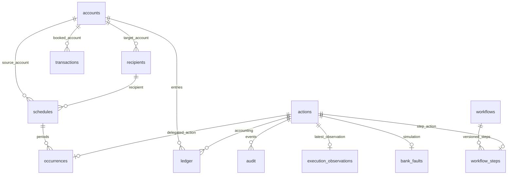

# SafeBank 数据库设计稿

日期：2026-10-08。状态：供架构改造审阅；未执行数据库变更。

依据现有 schema.sql、data.sql 和银行/任务业务代码。第一阶段沿用 13 张表及实际字段；以下明确持久化职责并列出后续约束增强要求，不凭空新增登录、真实支付或退款执行功能。

## 数据约定

金额使用 BIGINT 整数分；入账为正，支出为负，余额非负。金额转换仅在展示层发生。自然日用 DATE；过期及事件时刻用 TIMESTAMP WITH TIME ZONE，业务日历按既有 Asia/Shanghai 规则。主键保留 VARCHAR(80) 标识，不能统一改为自增，因为动作标识贯穿模型工具、授权、银行查单和恢复。

user_id 是可信的归属字段，来自会话。当前身份是合成用户，没有真实用户登录表。本地外部收款账户也在 accounts 中，user_id='external'；收款对象与目标账户不一定属于付款人。

## 表与字段

完整现行 DDL 位于 [schema.sql](../../src/main/resources/schema.sql)。本设计保留其长度与类型，增加清晰的职责、关联及迁移要求。

| 表 / Entity | 主要字段及含义 | 主键 / 业务唯一性 |
| --- | --- | --- |
| accounts / AccountEntity | id 标识；user_id 归属；label 显示名称；balance_minor 当前余额 | PK id；balance_minor≥0 已有 CHECK |
| recipients / RecipientEntity | id；user_id 联系人持有人；name、phone、note 消歧信息；account_id 指向合成目标账户 | PK id；姓名不唯一，不能按姓名猜收款人 |
| transactions / TransactionEntity | id；user_id 流水归属；account_id；merchant；category；amount_minor 有符号金额；booked_on 记账日 | PK id；转账派生 id 采用动作标识加 debit/credit 后缀 |
| mandates / MandateEntity | id；user_id；merchant；amount_minor 每周期金额；renewal_date；status 银行侧授权状态；contract_status 商户合同状态；billing_interval 周期 | PK id；银行撤销不能将合同状态自动设为已终止 |
| actions / ActionEntity | id；user_id；kind；payload 受控操作参数 JSON；payload_hash 授权绑定；status；expires_at；receipt_id；error_code | PK id；同一动作重复提交沿用此标识 |
| ledger / LedgerEntryEntity | id；action_id；account_id；amount_minor 借贷有符号金额 | PK id；UNIQUE(action_id,account_id) 已有 |
| schedules / ScheduleEntity | id；user_id；source_id 来源账户；recipient_id；amount_minor；day_of_month；first_date；end_date；status | PK id；登记计划不等于当前转账完成 |
| occurrences / ScheduleOccurrenceEntity | schedule_id；due_date 本期日期；action_id 对应动作 | PK(schedule_id,due_date) 已有；重复一期恢复原动作 |
| audit / AuditEventEntity | id；user_id；action_id；event；recorded_at | PK id；记录状态与操作事件，追加写入 |
| execution_observations / ExecutionObservationEntity | action_id；user_id；state 权威观察状态；receipt_id；error_code；observed_at | PK action_id；存最新观察而非重复创建动作 |
| bank_faults / BankFaultEntity | action_id；user_id；submit_mode；lookup_mode | PK action_id；仅合成实验使用 |
| workflows / WorkflowEntity | id；user_id；version 输入版本；state；request_json 明确用户选择；analysis_json 当时账单分析快照；created_at；updated_at | PK id；更新需 expectedVersion 与行锁 |
| workflow_steps / WorkflowStepEntity | workflow_id；step_key 逻辑步骤；input_version；kind；status；action_id；saving_minor 预计月度节省；error_code；evidence_json 已核验观察快照 | PK(workflow_id,step_key,input_version)；UNIQUE(action_id) 已有 |

实体字段类型：标识和 JSON 为 String，金额/版本为 Long 或 long（依空值契约），日期为 LocalDate，时间为 OffsetDateTime。可空字段不能用原始类型掩盖 null。状态使用明确枚举和 MyBatis 映射；读取遇到未知状态不得默认为成功。JSON 字段经受控 codec 转换成对应业务对象，不将任意 Entity 直接交给模型或网页。

## 关系

此图表示目标逻辑关系，不声称已有外键。动作 payload 中的 source_id / recipient_id / mandate_id 是按 kind 解码的业务引用，不能直接给整段 JSON 加普通外键。API 入参先作归属和存在性校验。

## 数据完整性增强

先扫描存量空值、孤儿记录和非法状态；有缺陷则出修复清单，不悄悄填充或删除。通过后才能执行增强迁移。第一阶段 Mapper 重构不同时改变这些约束。

- 外键目标：recipients.account_id、transactions.account_id、ledger.account_id、schedules.source_id → accounts.id；schedules.recipient_id → recipients.id；ledger/audit/execution_observations/bank_faults/occurrences/workflow_steps.action_id → actions.id；occurrences.schedule_id → schedules.id；workflow_steps.workflow_id → workflows.id。
- 所有外键采用拒绝破坏历史的策略，不级联删除账务、动作及回执；若日后支持删除用户，需单独定义归档策略。
- 对实际业务必填字段补 NOT NULL，含用户归属、流水金额/日期、计划参数、观察状态/时间、审计事件/时间。receipt_id 和 error_code 等按状态保留可空。
- mandates/schedules 的金额>0；day_of_month 为 1–28；first_date≤end_date；workflow version/input_version≥1；saving_minor≥0。
- mandates 的 billing_interval 按当前业务已识别的 MONTHLY/QUARTERLY/YEARLY 及未知值策略确定；不能将存量未知周期一律标为月度。迁移必须先查实际值再确定枚举 CHECK。
- actions/workflows/steps 的状态约束以当前全部允许状态为基础枚举，不能只允许成功/失败，必须容纳等待授权、处理中、未知、取消、部分成功。
- 本地转账的两条 ledger 金额之和为零是跨行约束，由同一数据库事务和业务核验保证；普通单行 CHECK 不能替代。
- 建议为 occurrences.action_id 增加唯一约束（每个委托转账动作仅属于一期），执行前检查历史是否满足；ER 图采用这一目标约束。

## 查询索引设计

| 建议索引 | 支持查询 |
| --- | --- |
| accounts(user_id,id) | 客户账户列表 |
| recipients(user_id,id) | 客户联系人读取；姓名模糊查询规模小，先不承诺普通索引能优化任意 contains |
| transactions(user_id,booked_on,id) | 月账单范围与稳定排序 |
| transactions(user_id,merchant,booked_on) | 周期消费统计，按查询计划确认后加入 |
| mandates(user_id,id) | 客户授权列表 |
| actions(user_id,status) | 客户动作状态筛选；按现有查询量决定是否加入 |
| schedules(user_id,first_date,id) | 计划列表 |
| audit(user_id,recorded_at) | 最新审计事件 |
| workflows(user_id,created_at,id) | 任务列表 |

ledger(action_id,account_id)、occurrences(schedule_id,due_date)、workflow_steps(workflow_id,step_key,input_version) 已有唯一键可服务相应查询，不重复机械创建同列索引。所有索引通过实际 SQL 和执行计划确认，避免为每列增加索引。

## 迁移与验收

1. 对当前数据库副本导出结构、行数、余额与重要状态；核对原 SQL 和上述设计。
2. 固定现有 DDL 为兼容基线；先建立 Entity/查询投影，再迁移 Mapper 和 Service，保持数据不变。
3. 所有 INSERT 显式列名，所有客户读写验证 user_id；正确保留行锁与事务范围。
4. 约束和索引增强用独立、可追踪版本的迁移，在副本验证后应用；旧实例不能与新实例同时写同一个文件库。
5. 验证启动两次不重复种子、重复提交不重复记账、余额回滚、每期唯一、任务恢复和旧库重启。

本文件是数据库设计评审材料，不是已经执行的升级。账号身份体系、真实银行接入、支付渠道和新增数据库平台均不属于这次分层改造。
